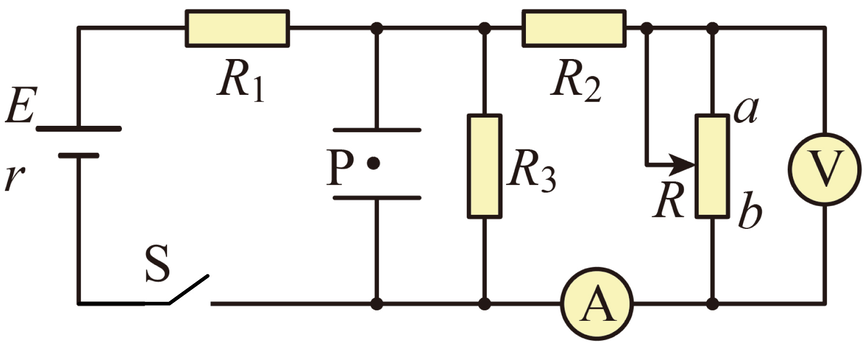

# Physics - 题目 1274

**ID**: 6488bc2bc54048a6818e4354d110b3f2
**年级**: Grade 12
**难度**: Medium-Hard
**题型**: Multiple-choice

## 题目
如图所示，电源电动势为E、内阻为 ${\rm \mathit{r}，}R{{}_{1}}、R{{}_{2}}、R{{}_{3}}$ 为定值电阻（阻值均大于电源内阻r），电压表和电流表均可视为理想电表。​​​​​​​‌开关S闭合时，一带电油滴P恰好能静止在平行金属板之间，若将滑动变阻器R的滑片向b端移动，则下列说法正确的是（      ）

## 解答

1. 滑动变阻器的滑片向 $b$ 端移动，则滑动变阻器接入电路的电阻减小，总电阻减小，则干路电流增大，则有 $U{{}_{{\rm{C}}}}=E-I{\rm{(}}R{{}_{1}}+r{\rm{)}}$ ，可知电容器两端电压减小，板间场强减小，油滴受到的电场力减小，故油滴将向下运动，故A错误；由于干路电流增大，而 $U{{}_{{\rm{C}}}}=U{{}_{3}}$ ，故 $R{{}_{3}}$ 两端电压 $U{{}_{3}}$ 减小，因此通过 $R{{}_{3}}$ 的电流 $I{{}_{3}}$ 减小，而 $I{{}_{干}}=I{{}_{2}}+I{{}_{3}}$ ，故流过 $R{{}_{2}}$ 的电流 $I{{}_{2}}$ 增大，电流表示数变大， $R{{}_{2}}$ 两端电压 $U{{}_{2}}$ 增大，而 $U{{}_{3}}=U{{}_{2}}+U{{}_{滑}}$ ，故滑动变阻器两端电压减小，即电压表示数变小，故B错误；设电压表示数为U，电流表示数为 $I$ ，根据闭合电路欧姆定律可得 $E=(I+\frac {U+IR{{}_{2}}}{R{{}_{3}}})(R{{}_{1}}+r)+U+IR{{}_{2}}$ ，整理可得 $E=I[\frac {(R{{}_{2}}+R{{}_{3}})(R{{}_{1}}+r)+R{{}_{2}}R{{}_{3}}}{R{{}_{3}}}]+U(\frac {R{{}_{1}}+r+R{{}_{3}}}{R{{}_{3}}})$ ，可知 $U$ 与 $I$ 成线性关系，即 $U-I$ 图像为一条倾斜的直线，所以图像的斜率不变，即电压表示数变化量与电流表示数变化量的比值不变，故C错误；由于 $R{{}_{外}}>r$ 且外电阻减小，与电源内阻越来越接近，故电源的输出功率增大，而电源效率为 $η=\frac {I{^{2}}R{{}_{外}}}{I{^{2}}(R{{}_{外}}+r)}\times 100\%=\frac {R{{}_{外}}}{(R{{}_{外}}+r)}\times 100\%=\frac {1}{1+\frac {r}{R{{}_{外}}}}\times 100\%$ ，外电阻减小，电源的效率减小，故D正确。

## 知识点

**中文**:
  - 平行板电容器电容大小及其影响因素
  - 电路的动态分析问题

**English**:
  - Factors Affecting Capacitance of Parallel Plate Capacitors
  - Dynamic Circuit Analysis

---
