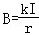
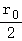
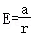
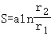
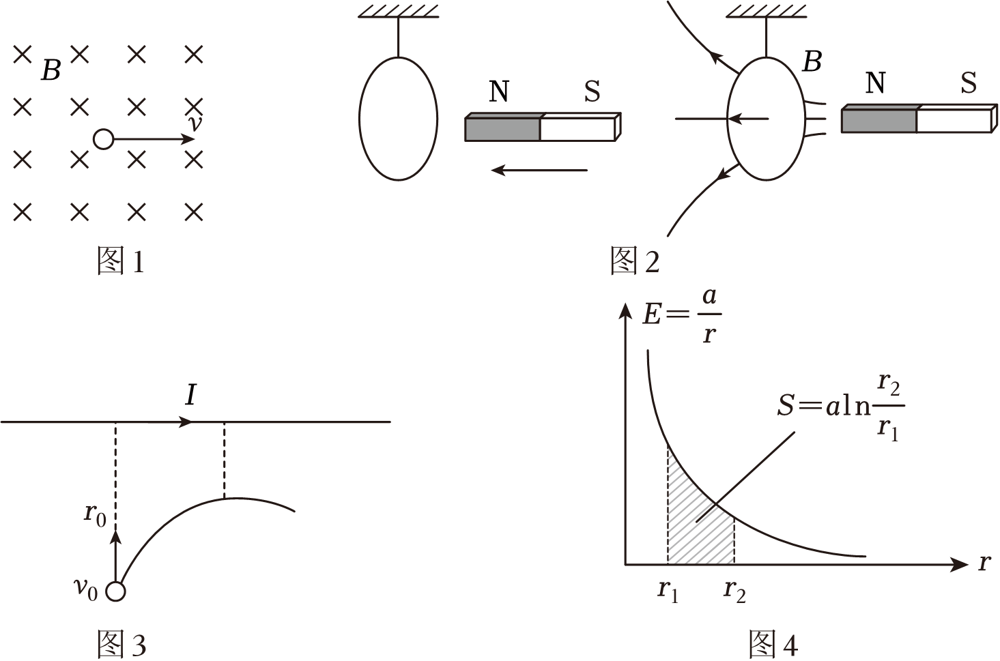

# Physics - 题目 421

**ID**: 6d862542fe4e44159d22cbeb44b55ea7
**年级**: Grade 12
**难度**: Medium-Hard
**题型**: 非选择题

## 题目
带电粒子间的电磁力是自然界四大基本相互作用力之一，电力和磁力是这一相互作用的两个部分，一个电磁相互作用是电现象还是磁现象，在很大程度上取决于研究问题所选取的参考系。​​​​​​​‌在一个参考系中观察到的磁现象，换一个参考系观察，可能就是电现象。这体现了电场和磁场是不可割裂的一个整体。电磁场的参考系变换，可以帮我们更好的理解并解决问题。（1）如图1所示，空间中存在垂直于纸面的匀强磁场，其大小为B，一带电粒子以垂直于磁场的速度v水平向右射入磁场。则粒子会受到洛伦兹力的作用。若此时在与粒子运动速度相同的惯性参考系∑′中观察，则粒子静止，静止的带电粒子不会受到洛伦兹力的作用。那么应该怎样解释它受到的力呢？原来在∑′中，由于磁场的运动，会观察到一个与磁场方向垂直的感生电场，请你求出该电场的大小和方向；（2）如图2所示，金属圆环被固定在竖直平面内（不能转动和平动），一个条形磁铁以匀速v靠近圆环，则圆环中会产生感应电动势。这一电动势有两种理解方式：在地面参考系∑中观察，圆环中的磁通量发生变化，因此圆环上存在感生电动势；若在与磁铁运动速度相同的惯性系∑′中观察，则系统变为圆环切割磁感线产生动生电动势。两个参考系下观察到的电动势应该完全相同。请分析，在参考系∑和参考系∑′中分别是什么力充当电动势中的非静电力？（3）某同学在面对这样一个问题时遇到了困难：在一个真空环境中，有一条载有电流I的、电阻很小的长直导线，已知电流在距离导线r处产生的磁感应强度，k为已知常数。初速度为v_{0}的电子在与导线垂直距离为r_{0}的初位置处开始垂直于导线向导线运动，如图3所示。已知电子运动过程中与导线的最短距离为，求电子初速度的大小。（不考虑地磁场影响，电子重力忽略不计）该同学希望用功能关系来求解电子的运动，但由于洛伦兹力不做功，因此电子到达距导线最近处时仍然保持初速率v_{0}，若利用洛伦兹力的分量做功的方式来计算，就显得十分复杂了。因此他希望在电磁场的参考系变换中获得启发，他选择在以速度为v_{0}，且相对导线水平向右运动的参考系∑′中进行研究。a。在参考系∑′中，空间中存在感生电场。根据（1）中的理论，距导线距离为r处的感生电场E的大小为（可用含v_{0}的表达式表示），方向与导线垂直，且（填“指向”或“背离”）导线。b。已知在参考系∑′中观察到的感生电场，具有与静电场类似的性质，其电场力做功只与始末位置到导线的距离r有关。请根据该同学选取的参考系，利用功能关系求满足题干要求的电子运动的初速度（已知电子电量为﹣e，电子质量为m，的图像与r轴在r_{1}到r_{2}区间与r轴围成的面积为，如图4所示）。

## 解答

1. （1）设粒子带正电+q，在地面参考系中，它受到的洛伦兹力为F＝qvB
2. 方向向上。因此在参考系∑′中所受的电场力亦为F＝qvB
3. 方向向上。且F＝qE
4. 得E＝vB
5. 方向垂直于v向上。
6. （2）在地面参考系中，由于磁场是运动的，因此存在感生电场，感生电场的电场力充当非静电力；在参考系Σ′中，洛伦兹力沿环方向的分力充当非静电力。
7. （3）a.根据第一问结论得
8. 方向指向通电导线
9. b.基于所选参考系可知，电子运动的初速度为，当电子运动到距导线最近时，速度为零。在此过程中受到的电场力为
10. 
11. 方向垂直于导线并背离导线。电场力做负功，其绝对值为E﹣r图在到r_{0}之间的面积，即W＝﹣ekIv_{0}ln2
12. 由动能定理，得
13. 得
14. 答：（1）该电场的大小为vB，方向垂直于v向上；
15. （2）在参考系∑和参考系∑′中分别是感生电场的电场力，洛伦兹力沿环方向的分力充当电动势中的非静电力感生电场的电场力，洛伦兹力沿环方向的分力；
16. （3）感生电场E的大小为，方向指向通电导线；电子运动的初速度为。

## 知识点

**中文**:
  - 洛伦兹力的方向与大小

**English**:
  - Direction and Magnitude of Lorentz Force

---
