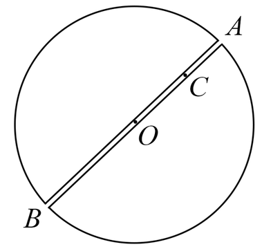

# Physics - 题目 1973

**ID**: 6eebcfc6ac2444699b3bcb979ec76e92
**年级**: Grade 12
**难度**: Medium-Hard
**题型**: Multiple-choice

## 题目
已知电荷均匀分布的球壳对内部点电荷的库仑力为零。​​​​​​​‌如图所示，在半径为R、电荷均匀分布的带正电球体内有一穿过球心O的光滑真空细通道，带负电的绝缘小球从入口A点由静止释放穿过通道到达球体另一端的B点，其中C点到O点的距离为x。若小球由A点释放瞬间加速度大小为a，不计小球重力，细通道及小球对球体电荷分布无影响。下列说法正确的是（      ）

## 解答

1. A．设电荷均匀分布的带正电球体所带的电荷量为 $Q$ ，带负电的绝缘小球所带的电荷量为 $q$ ，根据牛顿第二定律 $k\frac {Qq}{R{^{2}}}=ma$A点的加速度为 $a=k\frac {Qq}{mR{^{2}}}$C点以内带正电球体所带电荷量为 $Q{{}_{1}}=\frac {\frac {4}{3}πx{^{3}}}{\frac {4}{3}πR{^{3}}}Q=\frac {x{^{3}}}{R{^{3}}}Q$ ，根据牛顿第二定律，带电小球在C点处 $k\frac {Q{{}_{1}}q}{x{^{2}}}=ma{{}_{1}}$ ，解得带电小球在C点处的加速度为 $a{{}_{1}}=k\frac {Qq}{mR{^{2}}}\cdot \frac {x}{R}=a\cdot \frac {x}{R}$ ，A错误；
2. B．根据A项分析知小球在任一点的加速度大小与到O点的距离成正相关，带电小球在隧道内先做加速度减小的加速运动后做加速度增大的减速运动，B错误；
3. C．取A点为坐标原点，AB方向为正方向建立 $a-x$ 坐标系，如图
4. 
5. 图线与坐标轴所围面积乘以质量 $m$ 为合外力做的功，根据B项分析知O点时小球的加速度为零，速度最大，根据动能定理 $\frac {1}{2}ma\cdot R=\frac {1}{2}mv{{}_{{\rm{m}}}}{^{2}}$ ，解得带电小球的最大速度为 $v{{}_{{\rm{m}}}}=\sqrt {aR}$ ，C正确；
6. D．根据B项分析画出带电小球由A点运动到B点的 $v-t$ 图，如下
7. 
8. 知这个过程中的平均速度大于 $\frac {v{{}_{{\rm{m}}}}}{2}$ ，根据运动学规律知，带电小球由A点运动到B点的时间 $t<\frac {2R}{\frac {v{{}_{{\rm{m}}}}}{2}}=4\frac {R}{v{{}_{{\rm{m}}}}}=4\sqrt {\frac {R}{a}}$ ，D错误。选C。

## 知识点

**中文**:
  - 带电粒子在点电荷电场中的运动

**English**:
  - Motion in Point Charge Field

---
