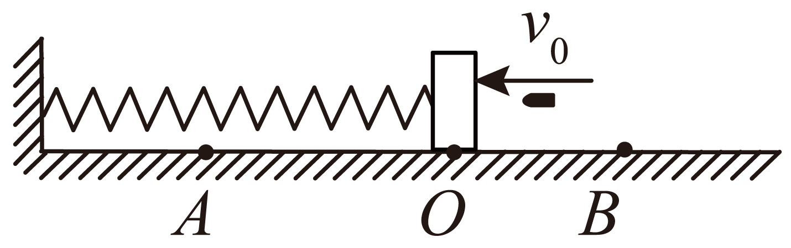

# Physics - 题目 969

**ID**: 70dfde27d8ae49efa63545707c13e5a2
**年级**: Grade 12
**难度**: Medium-Hard
**题型**: Multiple-choice

## 题目
如图所示，劲度系数为 $k$ 的轻质弹簧一端固定，另一端连接一质量为 $m$ 的小木块放置在粗糙程度相同的水平面上的 $O$ 点，此时弹簧长度为弹簧原长。​​​​​​​‌一颗质量为 $m{{}_{0}}$ 的子弹以水平速度 $v{{}_{0}}$ 击中木块，木块和子弹一起向左侧运动到 $A$ 点后向右运动，最远到达 $B$ 点，然后在 $O$ 点两侧往复运动。已知 $AO$ 之间的距离为 $L$ ，小木块与水平面的动摩擦因数为 $μ$ ，取重力加速度为 $g$ ，下列选项正确的是（      ）

## 解答

1. A．子弹打入小木块时，子弹与木块组成的系统动量守恒，可得 $m{{}_{0}}v{{}_{0}}=(m+m{{}_{0}})v$ ，解得 $v=\frac {m{{}_{0}}v{{}_{0}}}{m+m{{}_{0}}}{\rm ，A}$ 错误；
2. B．根据公式可得，小木块从开始运动到第一次回到 $O$ 点的过程中克服摩擦力做功为 $W{{}_{克{\rm{f}}}}=2μ(m+m{{}_{0}})gL{\rm ，B}$ 错误；
3. C．从 $A\to B$ 过程中， $O{{}_{1}}$ 为平衡位置，如图所示
4. 
5. 则有 $μ\left ({m+m{{}_{0}}}\right )g=kx{{}_{1}}$ ，规定向右为正向，滑块运动过程中的合力满足 $F=-kx$ ，其中 $x$ 为滑块偏离平衡位置 $O{{}_{1}}$ 的位移，由此可知从 $A\to B$ 过程中小滑块做简谐运动，简谐运动的振幅为 $A$ ，可知 $A=L{{}_{AO{{}_{1}}}}=L-x{{}_{1}}=L-\frac {μ(m+m{{}_{0}})g}{k}$  $OB$ 间的距离为 $L{{}_{OB}}=2A-L=L-\frac {2μ(m{{}_{0}}+m)g}{k}{\rm ，C}$ 正确；
6. D．根据简谐振动的规律可得，从 $A\to B$ 过程中滑块的振动可以表示为 $x=-A{\cos}(ωt)$ ，其中 $ω$ 为振动的角频率，满足 $ω=\sqrt {\frac {k}{m{{}_{0}}+m}}$ ，从 $A\to B$ 过程中， $O$ 点处为位移为 $x{{}_{O}}=\frac {μ(m{{}_{0}}+m)g}{k}$ ，解得 $t=\sqrt {\frac {m{{}_{0}}+m}{k}}{\arccos}[\frac {μ(m{{}_{0}}+m)g}{μ(m{{}_{0}}+m)g-kL}]{\rm ，D}$ 错误。选C。

## 知识点

**中文**:
  - 子弹-木块模型

**English**:
  - Bullet-Block Model

---
