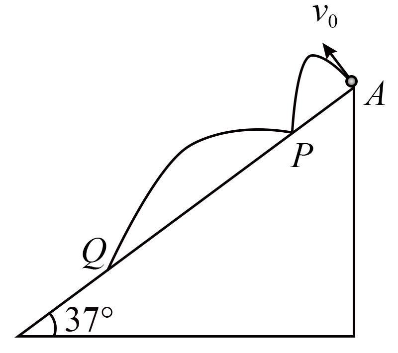

# Physics - 题目 2814

**ID**: 761865a07ec841b687fbf524b7e66a6b
**年级**: Grade 12
**难度**: Medium-Hard
**题型**: Multiple-choice

## 题目
如图所示，在倾角为 ${{3}}{{7}}{}\degree $ 足够长的斜面顶点A以速度 $v{{}_{0}}$ 垂直斜面抛出小球，小球落在斜面上的P点，在P点反弹后又落在斜面上的Q点，假设小球在P点反弹前后瞬间沿斜面方向的速度不变，垂直于斜面方向的速度等大反向，重力加速度为g，不计空气阻力， $\sin 37\mathrm{°}=0.​​​​​​​‌6$ ， ${\cos}37\mathrm{°}=0.8$ ，下列说法正确的是（      ）

## 解答

1. 将小球的运动沿平行斜面方向和垂直斜面方向分解，则沿平行斜面方向的初速度为零，垂直斜面方向的初速度为 $v{{}_{0}}$ ；同时将重力加速度沿平行斜面方向和垂直斜面方向分解，分别为 $a{{}_{//}}=g\sin 37{^{\circ }}$ ， $a{{}_{\bot }}=g{\cos}37{^{\circ }}$ ，可知小球此时的运动为沿平行斜面方向做初速度为0的匀加速直线运动，垂直斜面方向做类竖直上抛运动。根据运动的对称性原理，由垂直斜面方向的运动可知，小球从A到P和从P到Q运动时间相等，运动时间为 $t=2\times \frac {v{{}_{0}}}{g{\cos}37{^{\circ }}}=\frac {5v{{}_{0}}}{2g}$ ，故A错误；小球到达Q点时垂直斜面方向的速度大小为 $v{{}_{0}}$ ，方向垂直斜面向下；沿平行斜面方向的速度大小为 $v^{′}=g\sin 37{^{\circ }}\cdot 2t=3v{{}_{0}}$ ，故小球到达Q点时速度大小为 $v{{}_{Q}}=\sqrt {v^{′}{{^{2}}}+v{{}_{0}^{2}}}=\sqrt {10}v{{}_{0}}$ ，故C正确；设小球从A到P和从P到Q两次离斜面最远位置分别为M、N两点，如图所示
2. 
3. 可知这两点的速度方向与斜面平行，即只有沿平行斜面方向的速度，根据运动的对称性原理可知小球A到M点的时间为 $\frac {t}{2}{\rm ，\mathit{A}}$ 到N点的时间为 $\frac {3}{2}t$ ，则有 $v{{}_{M}}=g\sin 37{^{\circ }}\times \frac {t}{2}$ ， $v{{}_{N}}=g\sin 37{^{\circ }}\times \frac {3t}{2}$ ，解得M、N两点的速度大小之比为 $v{{}_{M}}:v{{}_{N}}=1:3$ ，故D错误；将 $v{{}_{0}}$ 沿水平方向和竖直方向分解，则有 $v{{}_{x}}=v{{}_{0}}\sin 37{^{\circ }}$ ， $v{{}_{y}}=v{{}_{0}}{\cos}37{^{\circ }}$ ，设小球从A点抛出后运动到轨迹最高点的时间为 $t{{}_{1}}$ ，当竖直方向的分速度为0时，小球到达轨迹的最高点，则有 $t{{}_{1}}=\frac {v{{}_{y}}}{g}=\frac {4v{{}_{0}}}{5g}$ ，故B错误。

## 知识点

**中文**:
  - 斜抛运动
  - 运动的合成与分解

**English**:
  - Oblique Projectile Motion
  - Composition and Resolution of Motion

---
