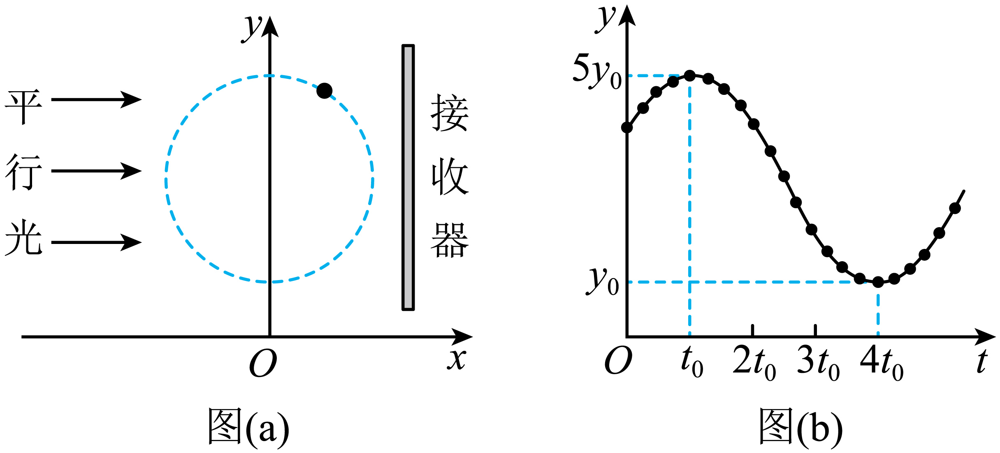

# Physics - 题目 506

**ID**: 7c4c4cd8f8db4a768e853f24326ef7bc
**年级**: Grade 12
**难度**: Medium-Hard
**题型**: Multiple-choice

## 题目
如图（a），在光滑绝缘水平桌面内建立直角坐标系Oxy，空间内存在与桌面垂直的匀强磁场。​​​​​​​‌一质量为m、带电量为q的小球在桌面内做圆周运动。平行光沿x轴正方向照射，垂直光照方向放置的接收器记录小球不同时刻的投影位置。投影坐标y随时间t的变化曲线如图（b）所示，则（      ）

## 解答

1. 设小球做匀速圆周运动的速度为 $v$ ，角速度为 $ω$ ，轨迹圆心在接收器上的投影坐标为Y，则在0时刻小球与轨迹圆心的连线与 $x$ 轴夹角为 $φ{{}_{0}}$ ，则经过时间t，小球在接收器上的投影坐标为 $y=R\sin (ωt+φ{{}_{0}})+Y$ ，由图（b）可得 $R=2y{{}_{0}}$ ， $Y=3y{{}_{0}}$ ， $T=\frac {2{\rm{π}}}{ω}=6t{{}_{0}}$ ，解得小球在接收器上的投影坐标与时间的关系式为 $y=2y{{}_{0}}\sin (\frac {{\rm{π}}}{3t{{}_{0}}}t+\frac {{\rm{π}}}{6})+3y{{}_{0}}$ 。
2. A．由上面分析可得，小球运动周期为 $T=6t{{}_{0}}$ ，小球在水平面上只受洛伦兹力，由洛伦兹力提供向心力有 $qBv=\frac {mv{^{2}}}{R}$ ，又因为 $T=\frac {2{\rm{π}}R}{v}=\frac {2{\rm{π}}m}{qB}$ ，解得磁场磁感应强度 $B=\frac {{\rm{π}}m}{3qt{{}_{0}}}{\rm ，A}$ 错误；
3. B．小球投影坐标对时间求导，可得 $v=\frac {dy}{dt}=\frac {2{\rm{π}}y{{}_{0}}}{3t{{}_{0}}}{\cos}(\frac {2{\rm{π}}}{3t{{}_{0}}}t+\frac {{\rm{π}}}{6})$ ，则投影的最大速度 $v{{}_{{\rm \max }}}=\frac {2{\rm{π}}y{{}_{0}}}{3t{{}_{0}}}{\rm ，B}$ 错误；
4. C．小球投影做简谐运动，C错误；
5. D．小球投影在 $3t{{}_{0}}$ 、 $4t{{}_{0}}$ 时刻的坐标分别为 $y{{}_{3}}=2y{{}_{0}}\sin (\frac {{\rm{π}}}{3t{{}_{0}}}\times 3t{{}_{0}}+\frac {{\rm{π}}}{6})+3y{{}_{0}}=2y{{}_{0}}$ ， $y{{}_{4}}=2y{{}_{0}}\sin (\frac {{\rm{π}}}{3t{{}_{0}}}\times 4t{{}_{0}}+\frac {{\rm{π}}}{6})+3y{{}_{0}}=y{{}_{0}}$ ， $3t{{}_{0}}\sim 4t{{}_{0}}$ 时间内，投影的位移大小为 $s=|y{{}_{4}}-y{{}_{3}}|=y{{}_{0}}{\rm ，D}$ 正确。选D。

## 知识点

**中文**:
  - 带电粒子的运动半径和周期公式及其简单应用
  - 简谐运动

**English**:
  - Radius and Period Formulas and Applications
  - Simple Harmonic Motion

---
