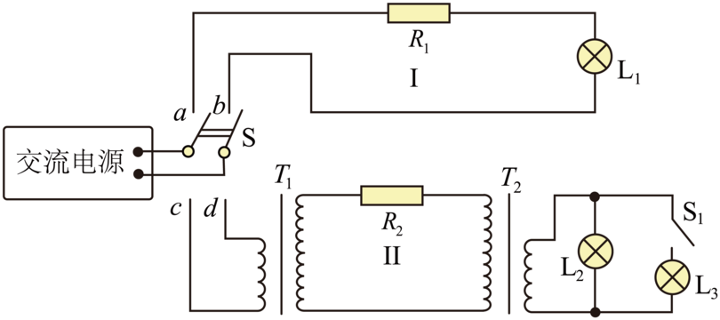

# Physics - 题目 2118

**ID**: 7c71b843071449518c70931531e007b0
**年级**: Grade 12
**难度**: Medium-Hard
**题型**: Multiple-choice

## 题目
远距离输电模拟电路如图所示，交流电源是输出电压为6V的正弦交流电，定值电阻 $R{{}_{1}}=R{{}_{2}}=6Ω$ ，小灯 ${\rm{L}}{{}_{{{1}}}}、{\rm{L}}{{}_{2}}、{\rm{L}}{{}_{3}}$ 规格一样，均为“6V，6W”，灯泡电阻可视为恒定不变。​​​​​​​‌理想变压器 $T{{}_{1}}、T{{}_{2}}$ 原、副线圈的匝数比分别为 $1:3$ 和 $3:1$ 。初始开关 ${\rm{S}}{{}_{{{1}}}}$ 断开，分别接通电路Ⅰ和电路Ⅱ，两电路都稳定工作时（      ）

## 解答

1. 小灯泡电阻 $R{{}_{L}}=\frac {6{^{2}}}{6}Ω=6Ω$ ，若开关接ab端，则流经灯 $L{{}_{1}}$ 的电流 $I{{}_{L{{}_{1}}}}=\frac {U}{R{{}_{1}}+R{{}_{L}}}=0.5{\rm{A}}$ ，若开关接cd端，升压变压器输出电压设为 $U{{}_{1}}$ ，由 $\frac {U{{}_{1}}}{U}=3$ ，得 $U{{}_{1}}=18{\rm{V}}$ ，降压变压器原线圈等效电阻 $R={\left({\frac {n{{}_{3}}}{n{{}_{4}}}}\right)^{2}}R{{}_{L}}=9R{{}_{L}}=54{\rm{Ω}}$ ，输电线上的电流 $I{{}_{2}}=\frac {U{{}_{1}}}{R{{}_{2}}+9R{{}_{L}}}=0.3{\rm{A}}$ ，流经灯 $L{{}_{2}}$ 的电流 $I{{}_{L{{}_{2}}}}=3I{{}_{2}}=0.9{\rm{A}}$ ，所以流经灯 $L{{}_{2}}$ 的电流大于则流经灯 $L{{}_{1}}$ 的电流，根据P=I^{2}R，可知灯 ${\rm{L}}{{}_{{{1}}}}$ 和 ${\rm{L}}{{}_{{{2}}}}$ 消耗功率之比为 $25:81$ ，选项A错误，B错误；电路Ⅱ稳定后闭合 ${\rm{S}}{{}_{1}}$ ，负载电阻变小，通过 $T{{}_{2}}$ 原线圈的电流变大，所以 $R{{}_{2}}$ 功率变大。由于损失电压变大，则 $U{{}_{3}}$ 变小， $U{{}_{4}}$ 变小，小灯泡 $L{{}_{2}}$ 功率变小，亮度变暗。选项C错误；电路Ⅱ稳定后闭合 ${\rm{S}}{{}_{1}}$ ，同理可得降压变压器原线圈等效电阻 $R^{′}=9\left ({\frac {1}{2}R{{}_{L}}}\right )=27{\rm{Ω}}$ ，输电线上的电流 $I^{′}{{{}_{2}}}=\frac {U{{}_{1}}}{R{{}_{2}}+R^{′}}=\frac {6}{11}{\rm{A}}$ ， $R{{}_{2}}$ 消耗的功率为 $P{{}_{R{{}_{2}}}}={\left({I^{′}{{{}_{2}}}}\right)^{2}}R{{}_{2}}=\frac {216}{121}{\rm{W}}$ ，选项D正确。

## 知识点

**中文**:
  - 含有理想变压器的动态电路分析
  - 理想变压器原、副线圈两端的电压、功率、电流关系及其应用

**English**:
  - Dynamic Circuit Analysis with Ideal Transformers
  - Voltage, Power, Current Relations in Ideal Transformers

---
