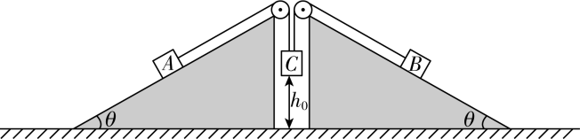

# Physics - 题目 2099

**ID**: 85e319823e02498baa21a0406363a79a
**年级**: Grade 12
**难度**: Medium-Hard
**题型**: 非选择题（本大题共5小题）

## 题目
（16分）如图所示，两个完全相同的直角三角形光滑斜面体固定在水平地面上，倾角θ均为30°，斜面体顶端均固定相同的轻质滑轮，两根等长的轻细线均绕过滑轮，一端与放在斜面上的质量均为m的物块A、B相连，另一端与质量为2m的物块C连接。​​​​​​​‌一开始用外力托住物块A、B、C，细线处于拉直状态，此时物块C距离地面高度为h_{0}，同时撤去外力后，物块C开始向下运动。已知物块C触地后速度立即变为零，物块C被提起时，细线瞬间绷直，绷直瞬间细线上的拉力非常大，从细线绷直到物块C再次落地前，细线均保持拉直状态，在整个运动过程中，细线始终不会脱离滑轮，物块A、B不会与滑轮相碰。不计一切摩擦，重力加速度为g，求：（1）物块C开始下落时的加速度大小a_{1}；（2）物块C第一次触地过程中损失的机械能ΔE；（3）物块C第一次触地后上升的最大高度h_{1}；（4）物块C从开始下落到最终停止运动所经历的时间t。

## 解答

1. （1）根据牛顿第二定律，
2. 对A，有T－mgsinθ＝ma_{1}
3. 对C，有 2mg－2T＝ma_{1}
4. 解得 ${\rm \mathit{a}_{1}＝}\frac{1}{4}{\rm \mathit{g}}$
5. （2）从C开始下落到C第一次触地前，有
6. ${v}_{1}^{2}{\rm ＝2\mathit{a}_{1}\mathit{h}_{0}}$
7. 物块C第一次触地过程中损失的机械能为
8. ${\rm Δ\mathit{E}＝}\frac{1}{2}{\rm ×2\mathit{m}}$  ${v}_{1}^{2}$ ，
9. 解得 ${\rm Δ\mathit{E}＝}\frac{1}{2}{\rm \mathit{mgh}_{0}}$
10. （3）物块C触地后，A、B先沿着斜面上滑再下滑，下滑至细线再次绷直时的速度仍为v_{1}，细线绷直瞬间，设一根细线上作用力的冲量大小为I，重力冲量因作用时间极短忽略不计，对A、C，根据动量定理得
11. －I＝mv_{2}－mv_{1}
12. 2I＝2mv_{2}－0
13. 解得 ${\rm \mathit{v}_{2}＝}\frac{1}{2}\sqrt{\frac{g{h}_{0}}{2}}$ ，
14. 物块C之后向上做 ${\rm \mathit{a}_{1}＝}\frac{1}{4}{\rm \mathit{g}}$ 的匀减速运动，上升最大高度设为h_{1}，则
15. ${\rm －}{v}_{2}^{2}{\rm ＝－2\mathit{a}_{1}\mathit{h}_{1}}$
16. 解得 ${\rm \mathit{h}_{1}＝}\frac{1}{4}{\rm \mathit{h}_{0}}$
17. （4）将“C到达最高点到下一次回到最高点的过程”看作第一过程，C由最高点下落过程有v_{1}＝a_{1}t_{1}
18. ${\rm \mathit{t}_{1}＝}\sqrt{\frac{8{h}_{0}}{g}}$ ，
19. A、B此后上滑后下滑至细线再次绷直，有
20. mgsinθ＝ma_{2}，
21. 2v_{1}＝a_{2}t_{2}
22. ${\rm \mathit{t}_{2}＝}\sqrt{\frac{8{h}_{0}}{g}}$ ，
23. 物块C上升至最高点过程有v_{2}＝a_{1}t_{3}
24. ${\rm \mathit{t}_{3}＝}\sqrt{\frac{2{h}_{0}}{g}}$ ，
25. 所用总时间t_{1}_{总}＝t_{1}＋t_{2}＋t_{3}＝5 $\sqrt{\frac{2{h}_{0}}{g}}$ ，
26. 第二个过程与第一个过程的区别在于初始下落高度由h_{0}变为 $\frac{1}{4}{\rm \mathit{h}_{0}}$ ，由第（3）问的方程可知第三次初始下落高度为 $\frac{1}{16}{\rm \mathit{h}_{0}}$ ，…
27. 故可得，第二过程所用总时间t_{2}_{总}＝5 $\sqrt{\frac{2{h}_{1}}{g}}{\rm ＝}$  $\frac{1}{2}$t_{1}_{总}，
28. 第三过程所用总时间t_{3}_{总}＝5 $\sqrt{\frac{2{h}_{2}}{g}}{\rm ＝}$  $\frac{1}{4}$t_{1}_{总}，
29. 第四过程所用总时间t_{4}_{总}＝5 $\sqrt{\frac{2{h}_{3}}{g}}{\rm ＝}$  $\frac{1}{8}$t_{1}_{总}，
30. ……
31. 物块C从开始运动到最终停止所用时间为
32. t＝t_{1}_{总}＋t_{2}_{总}＋…＋t_{n}_{总}＝10 $\sqrt{\frac{2{h}_{0}}{g}}$

## 知识点

**中文**:
  - 其他连接体问题中机械能守恒定律的应用
  - 动量定理及其应用
  - 动量和能量的综合应用

**English**:
  - Other Connected Body Problems
  - Applications of Impulse-Momentum Theorem
  - Integration of Momentum and Energy

---
