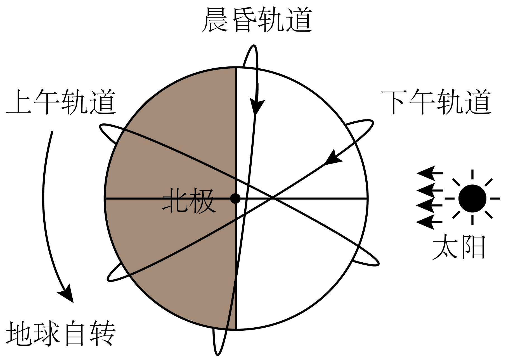

# Physics - 题目 961

**ID**: 87f096b36b454ccfb1d9a2ddaa385849
**年级**: Grade 12
**难度**: Medium-Hard
**题型**: Multiple-choice

## 题目
2021年7月我国成功将全球首颗民用晨昏轨道气象卫星——“风云三号05星”送入预定圆轨道，轨道周期约为1.7h，被命名为“黎明星”，使我国成为国际上唯一同时拥有晨昏、上午、下午三条轨道气象卫星组网观测能力的国家，如图所示。​​​​​​​‌某时刻“黎明星”正好经过赤道上P城市正上方，则下列说法正确的是（      ）

## 解答

1. A．7.9km/s为地球卫星的最大的环绕速度，所以“黎明星”做匀速圆周运动的速度小于7.9km/s。故A错误；
2. B．依题意可知“黎明星”的运行周期约为1.7h，根据开普勒第三定律可得
3. $\frac {r{{}_{1}^{3}}}{r{{}_{2}^{3}}}=\frac {T{{}_{1}^{2}}}{T{{}_{2}^{2}}}$
4. 解得同步卫星的轨道半径约为“黎明星”的6倍。故B错误；
5. C．该时刻后“黎明星”经过1.7h恰好运动一个周期，回到“原地”。但是由于地球自转，此时P城市转过的角度为
6. $θ=ωt=\frac {2π}{24}\times 1.7=\frac {17π}{120}$
7. 已经不在“原地”。故C错误；
8. D．同理，该时刻后“黎明星”经过17天运动的周期数为
9. $n=\frac {17\times 24}{1.7}个=240个$
10. 回到“原地”。由于地球自转，此时P城市转过的角度为
11. $θ=ωt=\frac {2π}{24}\times 17\times 24=34π$
12. 恰好回到“原地”。故D正确。
13. 故选D。

## 知识点

**中文**:
  - 非同步卫星问题

**English**:
  - Non-geostationary Satellites

---
