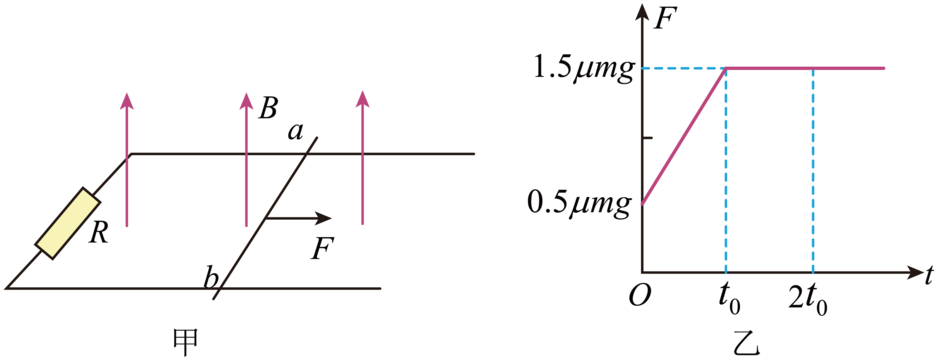

# Physics - 题目 130

**ID**: 8a951431b63c4dd09b839763a867d6cd
**年级**: Grade 12
**难度**: Medium-Hard
**题型**: Multiple-choice

## 题目
如图甲所示，一长直U型金属导轨在水平面内固定放置，导轨间距为L，电阻不计，在导轨的左端接有一个阻值为R的电阻。​​​​​​​‌质量为m的金属棒ab垂直导轨放置，与导轨之间的动摩擦因数为 $μ$ ，接入电路中的电阻为R。整个空间存在磁感应强度大小为B、方向竖直向上的匀强磁场。在 $t=0$ 时刻，对金属棒施加一个水平拉力F，F随时间变化的图像如图乙所示，金属棒运动过程中与导轨接触良好。在 $t=2t{{}_{0}}$ 时刻金属棒的速度达到最大值。已知重力加速度为g，假设最大静摩擦力的大小等于滑动摩擦力。下列说法正确的是（      ）

## 解答

1. A．对金属棒，达到最大速度时有： $BIL=F-{\rm μm}g$
2. 又因为 $I=\frac {BLv}{2R}$ ， $F=1.5{\rm μm}g$ ，最大速度 $v=\frac {{\rm μm}gR}{B{^{2}}L{^{2}}}$
3. 选项A错误；
4. B．由图像可知， $t=\frac {t{{}_{0}}}{2}$ 时刻， $F={\rm μm}g$ ， $0-\frac {t{{}_{0}}}{2}$ 时间内，物体受到静摩擦力作用，大小等于F，在 $0\sim 2t{{}_{0}}$ 时间内摩擦力的冲量大小 $I={\rm μm}g\cdot \frac {3t{{}_{0}}}{2}+\frac {\left ({0.5{\rm μm}g+{\rm μm}g}\right )}{2}\times \frac {t{{}_{0}}}{2}=\frac {15}{8}{\rm μm}gt{{}_{0}}$
5. 选项B错误；
6. CD．在 $0-2t{{}_{0}}$ 时间内，对导体棒，根据动量定理有： $\sum F\cdot t-\sum f\cdot t-\sum BIL\cdot t=mv-0$
7. 其中外力F的冲量为 $\sum F\cdot t=1.5{\rm μm}g\cdot t{{}_{0}}+\frac {\left ({0.5{\rm μm}g+1.5{\rm μm}g}\right )}{2}\times t{{}_{0}}=2.5{\rm μm}gt{{}_{0}}$
8. 摩擦力的冲量为 $\sum f\cdot t=I=\frac {15}{8}{\rm μm}gt{{}_{0}}$
9. 安培力的冲量为 $\sum BIL\cdot t=BL\cdot q=\sum \frac {B{^{2}}L{^{2}}v}{2R}\cdot t=\frac {B{^{2}}L{^{2}}x}{2R}$
10. q为流过金属棒的电荷量，x为金属棒的位移，解得 $q=\frac {5{\rm μm}gt{{}_{0}}}{8BL}-\frac {{\rm μm}{^{2}}gR}{B{^{3}}L{^{3}}}$ ， $x=\frac {5{\rm μm}gRt{{}_{0}}}{4B{^{2}}L{^{2}}}-\frac {2{\rm μm}{^{2}}gR{^{2}}}{B{^{3}}L{^{3}}}$
11. C正确，D错误；
12. 选C。

## 知识点

**中文**:
  - 电磁感应定律中的图像问题

**English**:
  - Graph Problems in EM Induction

---
