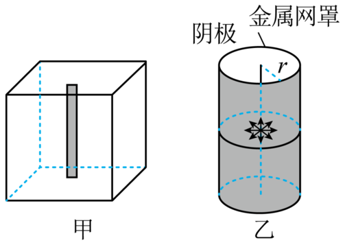

# Physics - 题目 1395

**ID**: 946df4049bfd4dc3b6513b561ac9bcfe
**年级**: Grade 12
**难度**: Medium-Hard
**题型**: 非选择题

## 题目
空心立方体（甲图）边长为2L，内壁六个表面涂有荧光粉。​​​​​​​‌位于中间的某电学器件如乙图，中间阴极是一根长为2L的细直圆柱形导体，阳极是环绕阴极半径为r（r远小于L）的金属网罩，单位时间从阴极均匀发射N个电子（初速度不计），经加速后从阳极小孔水平射出，撞到内壁被吸收，可使内壁发光。已知阴阳两极之间所加电压恒为U，电子质量m，电量e，电子重力、电子间相互作用力与其他阻力均不计。（1）若只加竖直向下的磁场，要使内壁不发光，求磁感应强度的最小值；（2）若只加竖直向下的电场，要使内壁的上表面全部发光，求电场强度的最大值；（3）现同时加竖直向下的磁场 $B=8\sqrt {\frac {2mU}{eL{^{2}}}}$ 和竖直向下的电场 $E=\frac {16U}{L}$ ，求内壁所受力的大小。（提示： $\sqrt {1}+\sqrt {2}+\sqrt {3}+\cdots +\sqrt {n}=\frac {2}{3}n{^{\frac {3}{2}}}$ ）

## 解答

1. （1）由动能定理得
2. $Ue=\frac {1}{2}mv{^{2}}$
3. 可得
4. $v=\sqrt {\frac {2Ue}{m}}$
5. 俯视图如图所示，有
6. 
7. $L=2R$
8. 洛伦兹力提供向心力
9. $qvB=\frac {mv{^{2}}}{R}$
10. 解得
11. $B=2\sqrt {\frac {2Um}{L{^{2}}e}}$
12. （2）由运动学公式可得
13. $\frac {1}{2}at{^{2}}=2L$
14. $x=vt$
15. $x=\sqrt {2}L$
16. 则
17. $E=\frac {4U}{L}$
18. （3）由于竖直方向的电场获得的速度与竖直磁场平行，所以粒子水平面内一边做匀速圆周运动，竖直面内做匀加速直线运动，互不影响；水平 $B$ 可知
19. $r=\frac {L}{8}$
20. 所有粒子均不会碰到侧面台壁，由于水平的速度的动量变化是对称的，不用考虑，仅考虑竖直的速度的动量变化即可，不同竖直位置的 $y$ 飞出到达上台面动量
21. $mv{{}_{y}}=mat=\sqrt {2meEy}$
22. 整个发射管取 $n$ 段，有
23. $y=\frac {2L}{n}i$ ， $0\leqslant i\leqslant n$ 且i为整数
24. 某位置 $y$ 飞出到达上台面有
25. $F{{}_{i}}Δt=\frac {N}{n}Δt\sqrt {2mEe\frac {2iL}{n}}$
26. 单位时间某位置 $y$ 飞出到达上台面时产生的作用力为
27. $F{{}_{i}}=\frac {N}{n}\sqrt {2mEe\frac {2iL}{n}}$
28. 对所有粒子求和
29. $F=\frac {N}{n}\sqrt {\frac {4emEL}{n}}(\sqrt {1}+\sqrt {2}+\cdots +\sqrt {n})=\frac {N}{n}\sqrt {\frac {4emEL}{n}}\cdot \frac {2}{3}n{^{\frac {3}{2}}}$
30. 解得
31. $F=\frac {16}{3}N\sqrt {meU}$

## 知识点

**中文**:
  - 带电粒子在匀强电场中的运动
  - 带电粒子在有界匀强磁场中的运动
  - 带电粒子在叠加场中的运动

**English**:
  - Motion in Uniform Electric Field
  - Motion in Bounded Uniform Magnetic Field
  - Motion in Superimposed Fields

---
