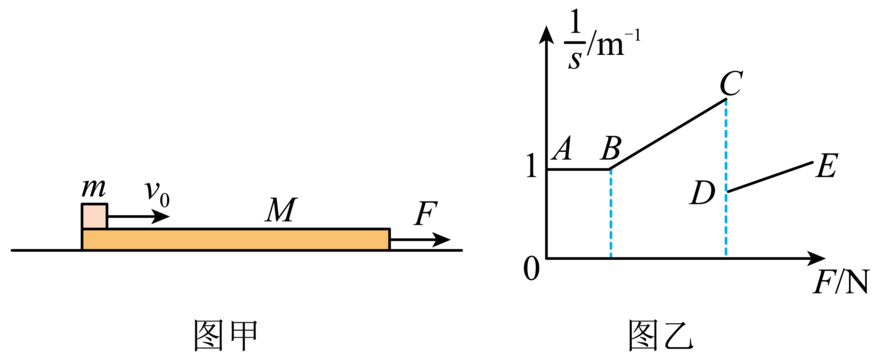

# Physics - 题目 1043

**ID**: 987ffb406b02445488b7734debad2255
**年级**: Grade 12
**难度**: Medium-Hard
**题型**: Multiple-choice

## 题目
如图甲所示，质量为M=0.5kg的木板静止在光滑水平面上，质量为m=1kg的物块以初速度v_{0}=4m/s滑上木板的左端，物块与木板之间的动摩擦因数为μ=0.2，在物块滑上木板的同时，给木板施加一个水平向右的恒力F。​​​​​​​‌当恒力F取某一值时，物块在木板上相对于木板滑动的路程为s，给木板施加不同大小的恒力F，得到 $\frac {1}{s}-F$ 的关系如图乙所示，其中AB与横轴平行，且AB段的纵坐标为1m^{-1}。将物块视为质点，最大静摩擦力等于滑动摩擦力，重力加速度g=10m/s^{2}。则下列说法正确的是（      ）

## 解答

1. F=0时，m和M系统动量守恒，取水平向右为正方向，由动量守恒定律和能量守恒定律得 $mv{{}_{0}}=mv{{}_{1}}+Mv{{}_{2}}$ ， $\frac {1}{2}mv{{}_{0}^{2}}-(\frac {1}{2}mv{{}_{1}^{2}}+\frac {1}{2}Mv{{}_{2}^{2}})={\rm μm}gs$ ，将M=0.5kg、m=1kg、 ${\rm \mathit{v}}{{}_{0}}{\rm =4m}$ /s、s=1m代入解 ${\rm \mathit{v}}{{}_{1}}{\rm =2m}$ / ${\rm s，\mathit{v}}{{}_{2}}{\rm =4m}$ /s(不符合情况，舍去)或 $v{{}_{1}}=\frac {10}{3}{\rm{m}}{\rm{/}}{\rm{s}}$ ， $v{{}_{2}}=\frac {4}{3}{\rm{m}}{\rm{/}}{\rm{s}}{\rm ，A}$ 错误；①当F较小时，物块将从木板右端滑下，当F增大到某一值时物块恰好到达木板的右端，且两者具有共同速度v，历时 ${\rm \mathit{t}}{{}_{1}}$ ，由牛顿第二定律得 $a{{}_{1}}=\frac {F+{\rm μm}g}{M}$ ， $a{{}_{{\rm{m}}}}=μg$ ，根据速度时间关系可得 $v=v{{}_{{{0}}}}-a{{}_{{\rm{m}}}}t{{}_{{{1}}}}{\rm{=}}=a{{}_{{{1}}}}t{{}_{{{1}}}}$ ，根据位移关系可得 $s=\frac {v{{}_{0}}+v}{2}t{{}_{1}}-\frac {v}{2}t{{}_{1}}=\frac {v{{}_{0}}}{2}t{{}_{1}}$ ，联立解得 $\frac {1}{s}=\frac {F+3}{4}$ ，由图乙知，相对路程 $s⩽1{\rm{m}}$ ，代入解得 $F⩾1{\rm{N}}$ ，②当F继续增大时，物块减速、木板加速，两者在木板上某一位置具有共同速度；当两者共速后能保持相对静止(静摩擦力作用)一起以相同加速度a做匀加速运动，由牛顿第二定律得 $a=\frac {F}{M+m}$ ，而 $f=ma$ ，由于静摩擦力存在最大值，所以 $f⩽f{{}_{{\rm{m}}{\rm{a}}{\rm{x}}}}={\rm μm}g=2{\rm{N}}$ ，联立解得 $F⩽3{\rm{N}}$ ，综上所述：BC段恒力F的取值范围是 $1{\rm{N}}⩽F⩽3{\rm{N}}$ ，函数关系式是 $\frac {1}{s}=\frac {F+3}{4}$ ，当F=3N时，有 $\frac {1}{s}=1.5$ ，则B点的横坐标为1N，C点的纵坐标为1. ${\rm 5}{\rm{m}}{^{-1}}{\rm ，B}$ 正确；当F较小时，物块将从木板右端滑下，当F增大到某一值时物块恰好到达木板的右端，且两者具有共同速度v，历时t_{1}，则木板的加速度 $a{{}_{1}}=\frac {F+{\rm μm}g}{M}$ ，滑块的加速度为 $a{{}_{{\rm{m}}}}=μg$ ，速度关系 $v=v{{}_{0}}-a{{}_{{\rm{m}}}}t{{}_{1}}=a{{}_{1}}t{{}_{1}}$ ，相对位移 $s=\frac {v{{}_{0}}+v}{2}t{{}_{1}}-\frac {v}{2}t{{}_{1}}$ ，联立解得 $F=1{\rm{N}}{\rm ，C}$ 错误；D(C)临界点对应的情况是物块滑至某处时，木板与物块已达到速度相同，且之后物块与木板之间恰达到最大静摩擦力两者一起加速运动的临界加速度为 $a=μg=2{\rm{m}}{\rm{/}}{\rm{s}}{^{2}}$ ，对整体，根据牛顿第二定律有 $F{{}_{D}}=(m+M)a=3{\rm{N}}{\rm ，D}$ 错误。

## 知识点

**中文**:
  - 动量和能量的综合应用
  - 板块模型
  - 动量守恒与板块模型相结合

**English**:
  - Integration of Momentum and Energy
  - Plate Model
  - Momentum Conservation with Plate Models

---
