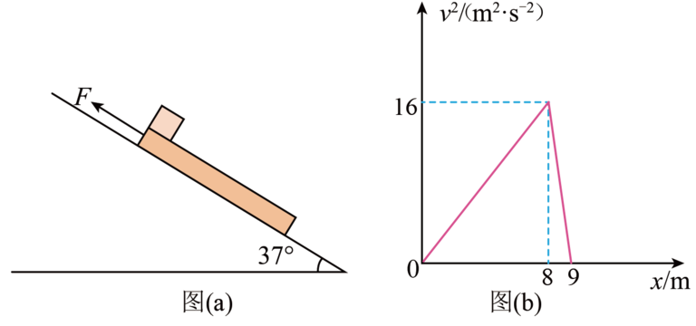

# Physics - 题目 1469

**ID**: 9aaf243244a1414c990b4bbe2903b2a5
**年级**: Grade 12
**难度**: Medium-Hard
**题型**: Multiple-choice

## 题目
如图（a）所示，物块和长木板置于倾角为 $θ=37{}^\circ $ 且足够长的斜面上。​​​​​​​‌ $t=0$ 时对长本板施加沿斜面向上的拉力F，使长木板和物块由静止开始沿斜面上滑，作用一段时间后撤去拉力 $F$ 。已知长木板和物块始终保持相对静止，两者上滑时速度的平方与位移之间的关系 $v^{2}-x$ 图像如图（b）所示，已知 ${\sin}37{}^\circ =0.6$ ， ${\cos}37{}^\circ =0.8$ ，重力加速度取 $g=10{\rm{m}}/{\rm{s}}^{2}$ ，最大静摩擦力认为等于滑动摩擦力，则下列说法正确的是（      ）

## 解答

1. B．由图（b）知，斜率的绝对值等于加速度的2倍
2. $a_{1}=\frac {v^{2}}{2x}=\frac {1}{2}\times \frac {16}{8}{\rm{m}}{\rm{/}}{\rm{s}}^{2}=1{\rm{m}}{\rm{/}}{\rm{s}}^{2}$
3. B错误；
4. A．撤去拉力时的速度
5. $v=2\sqrt {2{\rm{m}}{\rm{/}}{\rm{s}}}$
6. 拉力作用时间为
7. $t_{1}=\frac {v}{a_{1}}=2\sqrt {2}{\rm{s}}$
8. A错误；
9. C．撤去拉力时的加速度
10. $a_{2}=\frac {v^{2}}{2x}=\frac {1}{2}\times \frac {16}{1}{\rm{m}}{\rm{/}}{\rm{s}}^{2}=8{\rm{m}}{\rm{/}}{\rm{s}}^{2}$
11. 由牛顿第二定律
12. $\left ({M+m}\right )g{\sin}θ+μ_{1}\left ({M+m}\right )g{\cos}θ=\left ({M+m}\right )a_{2}$
13. 解得
14. $μ_{1}=0.25$
15. C正确；
16. D．物块与长木板之间无相对滑动，由牛顿第二定律
17. $μ_{2}mg{\cos}θ-mg{\sin}θ\geqslant ma_{1}$
18. 解得
19. $μ_{2}\geqslant 0.875$
20. 物块与长木板之间的动摩擦因数不可能为0.75，D错误。
21. 故选C。

## 知识点

**中文**:
  - 非常规图像问题

**English**:
  - Non-standard Graph Problems

---
