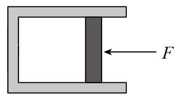

# Physics - 题目 402

**ID**: 9f83c5022c3c47ac9097365ea68dd925
**年级**: Grade 12
**难度**: Medium-Hard
**题型**: Multiple-choice

## 题目
如图所示，固定的绝热气缸内用活塞（活塞与气缸壁无摩擦，不漏气，且不导热）密封一定质量的理想气体，气缸置于温度不变的环境中。​​​​​​​‌现用力F使活塞向左缓慢移动，密闭气体的状态发生了变化。用n表示单位体积内气体的分子数，p、V分别表示该气体的压强、体积， $\bar E{{}_{k}}$ 表示该气体分子的平均动能，U表示内能，下列四个图象（图中a、b为双曲线，c、d为直线）符合上述过程的是（      ）

## 解答

1. A．一定质量的理想气体，单位体积内气体的分子数为 $n=\frac {N}{V}$ ，N为所有气体的分子数，所以n-V图象是双曲线，故A正确；
2. B．气缸和活塞都绝热，现用力F使活塞缓慢地向左移动，密闭气体的压强变大，体积变小，活塞对气体做功，根据热力学第一定律知，气体内能增大，温度升高，但气体不是发生等温变化，所以p-V图象不是双曲线，故B错误；
3. C．温度是分子平均动能变化的标志，所以该气体分子的平均动能随着气体体积的减小而增大，故C错误；
4. D．气缸内气体温度升高，则气体的内能增大，故D错误。
5. 故选A。

## 知识点

**中文**:
  - 热力学第一定律及其应用

**English**:
  - First Law of Thermodynamics and Applications

---
