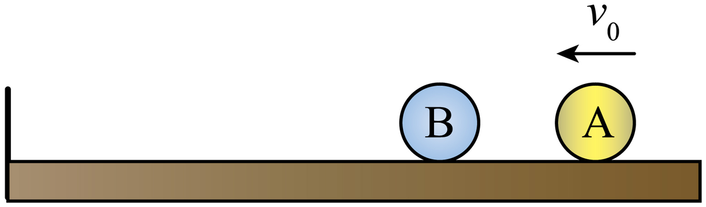

# Physics - 题目 1581

**ID**: 9fddbfbbee5f4e468bb8c7bf76cad18c
**年级**: Grade 12
**难度**: Medium-Hard
**题型**: Multiple-choice

## 题目
如图，一光滑直线轨道上静止有相同大小的A、B两球，B球左侧6m处有一竖直挡板，B球与之碰撞后能等速率弹回。​​​​​​​‌A以2m/s的速度与B发生弹性正碰，且碰后A仍向左运动。两球可视为质点，则两球前后两次碰撞期间，B球运动的路程可能为（      ）

## 解答

1. 设A球的质量为M，B球的质量为m，由于碰后A仍向左运动，则 $M>m$ ，设两球第一次碰撞后速度分别为 $v{{}_{{\rm{A}}}}$ 、 $v{{}_{{\rm{B}}}}$ ，两球碰撞为弹性碰撞，则根据动量守恒可得 $Mv{{}_{0}}=Mv{{}_{{\rm{A}}}}+mv{{}_{{\rm{B}}}}$ ，根据能量守恒可得 $\frac {1}{2}Mv{{}_{0}^{2}}=\frac {1}{2}Mv{{}_{{\rm{A}}}^{2}}+\frac {1}{2}mv{{}_{{\rm{B}}}^{2}}$ ，联立解得 $v{{}_{{\rm{A}}}}=\frac {M-m}{M+m}v{{}_{0}}=\frac {2(M-m)}{M+m}$ ， $v{{}_{{\rm{B}}}}=\frac {2M}{M+m}v{{}_{0}}=\frac {4M}{M+m}{\rm ，B}$ 球运动到挡板处的时间 $t=\frac {x{{}_{0}}}{v{{}_{{\rm{B}}}}}=\frac {6}{\frac {4M}{M+m}}=\frac {3(M+m)}{2M}$ ，此过程A球运动的距离为 $x{{}_{{\rm{A}}}}=v{{}_{{\rm{A}}}}t=\frac {2(M-m)}{M+m}\times \frac {3(M+m)}{2M}=\frac {3(M-m)}{M}{\rm ，A}$ 球到挡板的距离为 $ΔL=x{{}_{0}}-x{{}_{{\rm{A}}}}=6-\frac {3(M-m)}{M}$ ，设经过 $t{{}_{0}}$ 时间两球再次相碰，则有 $(v{{}_{{\rm{A}}}}+v{{}_{{\rm{B}}}})t{{}_{0}}=ΔL$ ，解得 $t{{}_{0}}=\frac {3(M+m){^{2}}}{2M(3M-m)}$ ，此过程B球运动的距离 $x{{}_{{\rm{B}}}}=v{{}_{{\rm{B}}}}t{{}_{0}}=\frac {4M}{M+m}\times \frac {3\left ({M+m}\right )\left ({M+m}\right )}{M\left ({6M-2m}\right )}=\frac {6\left ({M+m}\right )}{3M-m}$ ，两次碰撞前后B球运动的路程为 $s{{}_{{\rm{B}}}}=x{{}_{0}}+x{{}_{{\rm{B}}}}=6{\rm{m}}{{+}}\frac {6(M+m)}{3M-m}$ ，由于 $M>m$ ，近似处理可知 $x{{}_{{\rm{B}}}}>2{\rm{m}}$ ，则 $s{{}_{{\rm{B}}}}>8{\rm{m}}$ 。

## 知识点

**中文**:
  - 机械能守恒及其判断
  - 求解弹性碰撞问题

**English**:
  - Judgment of Mechanical Energy Conservation
  - Solving Elastic Collision Problems

---
