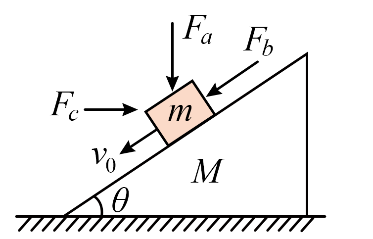

# Physics - 题目 460

**ID**: a496c51b83f34421b06fe7675e980da6
**年级**: Grade 12
**难度**: Medium-Hard
**题型**: Multiple-choice

## 题目
一斜块 $M$ 静止于粗糙的水平面上，在其斜面上放一滑块 $m$ ，若给 $m$ 一向下的初速度 $v{{}_{0}}$ ，则 $m$ 正好保持匀速下滑，如图所示，现在 $m$ 下滑的过程中再加一个作用力，则以下说法正确的是（      ）​​​​​​​‌

## 解答

1. 若给 $m$ 一向下的初速度 $v{{}_{0}}$ ，则 $m$ 正好保持匀速下滑，对m，有 $mg\sin θ={\rm μm}g{\cos}θ$ ，即得 $\sin θ=μ{\cos}θ{\rm ，\mathit{θ}}$ 是斜面的倾角。
2. A．当施加竖直向下的力 $F{{}_{a}}$ 时，对整体受力分析，水平方向不受摩擦力，否则不能平衡，对地面也没有摩擦力，再对m受力分析可知 $\left ({mg+F{{}_{a}}}\right )\sin θ-μ\left ({mg+F{{}_{a}}}\right ){\cos}θ=0$ ，所以m依然做匀速运动，A错误；
3. B．在m上加一沿斜面向下的力 $F{{}_{b}}$ ，但m与斜面间的弹力大小不变，滑动摩擦力大小不变，即物块所受支持力与摩擦力的合力仍然竖直向上，则斜面所受摩擦力与物块的压力的合力竖直向下，则斜面水平方向仍无运动趋势，仍对地无摩擦力作用，所以物块所受的合力将沿斜面向下，做加速运动，B错误；
4. C．在m上加一水平向右的力 $F{{}_{c}}$ ，沿斜面方向，有 $mg\sin θ-F{{}_{c}}{\cos}θ-μ(mg{\cos}θ+F{{}_{c}}\sin θ)<0$ ，物体做减速运动，对物块，所受支持力增加了 $F{{}_{c}}\sin θ$ ，则摩擦力增加 $μF{{}_{c}}\sin θ$ ，即支持力与摩擦力均成比例的增加，其合力方向还是竖直向上，如图：
5. 
6. 则斜面所受的摩擦力与压力的合力放还是竖直向下，水平方向仍无运动趋势，则不受地面的摩擦力，C正确；
7. D．无论在m上加上什么方向的力，m对斜面的压力与m对斜面的摩擦力都是以 $1:μ$ 的比例增加，则其合力的方向始终竖直向下，但大小会发生变化，所以加不同方向的外力，停止前 $M$ 对地的压力大小会发生变化，D错误。选C。

## 知识点

**中文**:
  - 在共点力平衡中整体法与隔离法的应用
  - 正交分解法与三角形定则在平衡问题中的应用

**English**:
  - Whole and Isolation Methods in Equilibrium
  - Orthogonal Decomposition and Triangle Rule in Equilibrium

---
