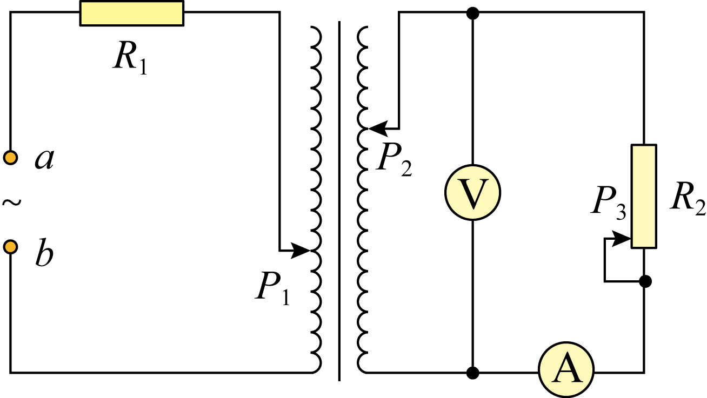

# Physics - 题目 843

**ID**: a793dba8355641d5a140f437ac6a2332
**年级**: Grade 12
**难度**: Medium-Hard
**题型**: Multiple-choice

## 题目
如图所示，一原副线圈匝数均可调节的理想变压器，输入端 $a$ 、 $b$ 接入有效值恒定的交流电源，已知定值电阻 $R{{}_{1}}$ 阻值为 $R$ ，滑动变阻器 $R{{}_{2}}$ 的最大阻值为 $4R$ ，初始时刻原、副线圈的匝数之比为 $1:2$ ，滑片 $P{{}_{3}}$ 位于最下端，理想电压表的示数、示数变化量的大小分别用 $U$ 、 $\Delta U$ 表示，理想电流表的示数、示数变化量的大小分别用 $I$ 、 ${\rm{Δ}}I$ 表示。​​​​​​​‌不计其余电阻，下列说法正确的是（      ）

## 解答

1. 设输入端 $a$ 、 $b$ 电压为 $U{{}_{0}}$ ，理想变压器原线圈电压为 $U{{}_{1}}$ 、电流为 $I{{}_{1}}$ ，副线圈电压为 $U{{}_{2}}$ 、电流为 $I{{}_{2}}$ ，则保持 $P{{}_{1}}$ 、 $P{{}_{2}}$ 位置不变，匝数比为 $1:2$ ，则根据理想变压器相关公式可知， $R{{}_{2}}$ 在原线圈中的等效电阻为 $R^{′}={\left({\frac {1}{2}}\right)^{2}}R{{}_{2}}$ ，则原线圈电流 $I{{}_{1}}=\frac {U{{}_{0}}}{R{{}_{1}}+R^{′}}$ ，原线圈电压 $U{{}_{1}}=U{{}_{0}}-I{{}_{1}}R{{}_{1}}$ ， $P{{}_{3}}$ 向上滑动过程中 $R{{}_{2}}$ 减小，则 $R^{′}$ 减小， $I{{}_{1}}$ 增大， $U{{}_{1}}$ 减小，根据理想变压器 $\frac {U{{}_{1}}}{U{{}_{2}}}=\frac {1}{2}$ ， $\frac {I{{}_{1}}}{I{{}_{2}}}=2$ ，可知 $I{{}_{2}}$ 增大、 $U{{}_{2}}$ 减小，A错误；设 $R{{}_{1}}$ 两端电压为 $U{{}_{R}}$ ，则原线圈满足 $U{{}_{0}}=U{{}_{1}}+U{{}_{R}}$ ，则 $\left |{ΔU{{}_{1}}}\right |=\left |{ΔU{{}_{R}}}\right |$ ，所以 $\left |{\frac {{\rm{Δ}}U{{}_{1}}}{{\rm{Δ}}I{{}_{1}}}}\right |=\left |{\frac {{\rm{Δ}}U{{}_{R}}}{{\rm{Δ}}I{{}_{1}}}}\right |=R{{}_{1}}$ ，根据变压器规律可知，变压器原副线圈电压变化量之比 $\left |{\frac {{\rm{Δ}}U{{}_{1}}}{{\rm{Δ}}U{{}_{2}}}}\right |=\frac {n{{}_{1}}}{n{{}_{2}}}=\frac {1}{2}$ ，电流变化量之比 $\left |{\frac {{\rm{Δ}}I{{}_{1}}}{{\rm{Δ}}I{{}_{2}}}}\right |=\frac {n{{}_{2}}}{n{{}_{1}}}=2$ ，则 $\frac {{\rm{Δ}}U}{{\rm{Δ}}I}=\left |{\frac {{\rm{Δ}}U{{}_{2}}}{{\rm{Δ}}I{{}_{2}}}}\right |={\left({\frac {n{{}_{2}}}{n{{}_{1}}}}\right)^{2}}·\left |{\frac {{\rm{Δ}}U{{}_{1}}}{{\rm{Δ}}I{{}_{1}}}}\right |=2{^{2}}R{{}_{1}}=4R{{}_{1}}$ ，则保持 $P{{}_{1}}$ 、 $P{{}_{2}}$ 位置不变， $P{{}_{3}}$ 向上缓慢滑动的过程中， $\frac {ΔU}{ΔI}$ 不变，B错误；由A选项分析可知，则保持 $P{{}_{1}}$ 、 $P{{}_{2}}$ 位置不变， $R{{}_{2}}$ 在原线圈中的等效电阻为 $R^{′}={\left({\frac {1}{2}}\right)^{2}}R{{}_{2}}=\frac {1}{4}R{{}_{2}}$ ，变压器输出功率为 $P=I{{}_{1}}{^{2}}R^{′}=\frac {U{{}_{0}}{^{2}}R^{′}}{{\left({R{{}_{1}}+R^{′}}\right)^{2}}}=\frac {U{{}_{0}}{^{2}}}{R^{′}+\frac {R{{}_{1}}{^{2}}}{R^{′}}+2R{{}_{1}}}$ ，当且仅当 $R^{′}=R{{}_{1}}=R$ 时输出功率最大 $P{{}_{{\rm \max }}}=\frac {U{{}_{0}}{^{2}}}{4R}$ ，由于 $R{{}_{2}}$ 最大阻值为 $4R$ ，则 $P{{}_{3}}$ 向上滑动过程中，等效电阻 $R^{′}$ 最大值为 $R$ 且在逐渐降低，所以变压器输出功率由最大逐渐减小，则副线圈的输出功率逐渐减小，C正确；保持 $P{{}_{3}}$ 位置不变， $P{{}_{1}}$ 、 $P{{}_{2}}$ 向上移动，使原副线圈增加相同的匝数 $Δn$ 后， $R{{}_{2}}$ 在原线圈中的等效电阻为 $R^{′}={\left({\frac {1+{\rm{Δ}}n}{2+{\rm{Δ}}n}}\right)^{2}}R{{}_{2}}>\frac {1}{4}R{{}_{2}}$ ，由C选项分析可知，当且仅当 $R^{′}=R{{}_{1}}=R$ 时输出功率最大，所以原副线圈增加相同的匝数 $Δn$ 后变压器输出功率降低，D错误。

## 知识点

**中文**:
  - 含有理想变压器的动态电路分析

**English**:
  - Dynamic Circuit Analysis with Ideal Transformers

---
