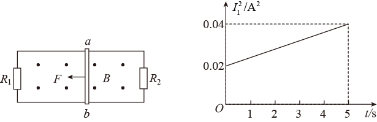

# Physics - 题目 2148

**ID**: b1af75ecb0b844808a6bd7143710c2d0
**年级**: Grade 12
**难度**: Medium-Hard
**题型**: Multiple-choice

## 题目
如图所示，光滑且足够长的两平行金属导轨固定在同一水平面上，两导轨间的距离 $L=1{\rm{m}}$ ，定值电阻 $R{{}_{1}}=6{\rm{Ω}}$ 、 $R{{}_{2}}=3{\rm{Ω}}$ ，导轨上放一质量为 $m=1{\rm{k}}{\rm{g}}$ 的金属导体棒 $ab$ ，棒的电阻 $r=2{\rm{Ω}}$ 。​​​​​​​‌整个装置处于磁感应强度为 $B=0.8{\rm{T}}$ 的匀强磁场中，磁场的方向垂直于导轨平面向上，现用一拉力 $F$ 沿水平方向向左拉棒，使棒以一定的初速度开始运动，如图为 $R{{}_{1}}$ 中电流的平方 $I{{}_{1}^{2}}$ 随时间 $t$ 的变化关系图像，导轨的电阻不计。下列说法正确的是（      ）

## 解答

1. 外电路总电阻 $R{{}_{外}}=2{\rm{Ω}}$ ，由 $I{{}_{1}^{2}}$ 随时间 $t$ 的变化关系图像得 $5{\rm{s}}$ 末的电流 $I{{}_{1}}=0.2{\rm{A}}$ ， $I{{}_{总}}=3I{{}_{1}}=0.6{\rm{A}}$ ，，由 $E=BLv$ ，解得 $v=\frac {E}{BL}=\frac {2.4}{0.8\times 1}{\rm{m}}{\rm{/}}{\rm{s}}=3{\rm{m}}{\rm{/}}{\rm{s}}{\rm ，A}$ 错误；根据 $I{{}_{1}^{2}}$ 随时间 $t$ 的变化关系图像的图线与时间轴包围的“面积”为， $5{\rm{s}}$ 内 $R{{}_{1}}$ 中产生的焦耳热为 $Q{{}_{1}}=0.15\times 6{\rm{J}}=0.9{\rm{J}}{\rm ，B}$ 错误；电路中总电热 $Q{{}_{总}}=Q{{}_{1}}+Q{{}_{2}}+Q{{}_{r}}=6Q{{}_{1}}=5.4{\rm{J}}$ ，同理，可算出 $t=0$ 时 $E{{}_{0}}=\frac {6}{5}\sqrt {2}{\rm{V}}$ ，棒的初始速度 $v{{}_{0}}=\frac {E{{}_{0}}}{BL}=\frac {3\sqrt {2}}{2}{\rm{m}}{\rm{/}}{\rm{s}}$ ，由功能关系得 $W{{}_{F}}+W{{}_{{\rm{A}}}}=\Delta E{{}_{{\rm{k}}}}$ ，解得，C正确； $I{{}_{1}^{2}}$ 随时间 $t$ 的变化关系图像的方程为，得 $I{{}_{1}}=0.1\sqrt {2+0.4t}{\rm{A}}$ ， $I{{}_{总}}=3I{{}_{1}}=0.3\sqrt {2+0.4t}{\rm{A}}$ ，安培力 $F{{}_{{\rm{A}}}}=BI{{}_{总}}L=0.24\sqrt {2+0.4t}{\rm{N}}{\rm ，D}$ 错误。

## 知识点

**中文**:
  - 单杆模型
  - 电磁感应现象中的功能问题
  - 电磁感应定律中的图像问题

**English**:
  - Single Rod Model
  - Work-Energy Problems in EM Induction
  - Graph Problems in EM Induction

---
