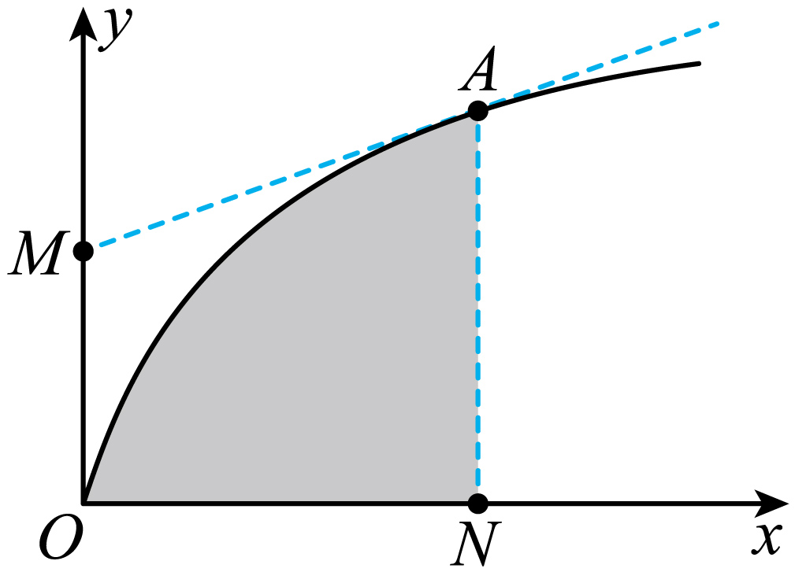

# Physics - 题目 2942

**ID**: b5afef34f5384acaa4c57c75b6023bf6
**年级**: Grade 12
**难度**: Medium-Hard
**题型**: Multiple-choice

## 题目
如图所示，若令x轴和y轴分别表示某个物理量，则图像可以反映某种情况下物理量之间的关系，在有些情况中，图线上任一点的切线斜率、图线与x轴围成的面积也有相应的物理含义。​​​​​​​‌A为图线上一点，过A点作图线的切线交y轴于M点，过A点作垂线交x轴于N点，切线AM的斜率记为k，图中的阴影面积记为S。下列说法正确的是（      ）

## 解答

1. 根据 $P=UI$ ，对于一段只含有电热元件的电路，若x轴表示电流I，y轴表示电压U，因P、U、I均为状态量，并非过程量，可知面积S不可以表示电流在这段电路中做功的功率。A错误；根据 $P=Fv$ ，对于做直线运动的物体，若x轴表示速度v，y轴表示物体所受的合外力F，因F、v为状态量，所以面积S不可以表示某速度时对应的合外力做功的瞬时功率。B错误；根据 $q=It$ ，可知若x轴表示时间t，y轴表示电量q，斜率k可以表示电容器在充电过程中对应时刻的电流大小。C正确；根据 $v=ωr$ ，若x轴表示半径r，y轴表示线速度v，因r、v是状态量，所以斜率k不可以表示对应半径的角速度大小。D错误。

## 知识点

**中文**:
  - 电流的形成、理解与微观表达式
  - 线速度、角速度和周期、转速

**English**:
  - Formation, Understanding, and Microscopic Expression of Current
  - Linear Velocity, Angular Velocity, Period, and Rotational Speed

---
