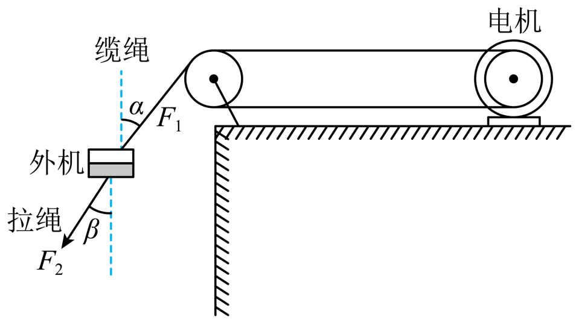

# Physics - 题目 787

**ID**: bad3e6e0d1c54094b165c8e3c64e5e26
**年级**: Grade 12
**难度**: Medium-Hard
**题型**: Multiple-choice

## 题目
拆卸高楼旧空调外机时，常用电动机通过缆绳进行牵引，为避免其与竖直墙壁碰撞，地面上的工人（图中未画出）用一根拉绳拽着外机，如图所示。​​​​​​​‌设缆绳拉力的大小为F_{1}，方向与竖直方向成 $α$ 角；拉绳拉力大小为F_{2}，与竖直方向的夹角为β。工人拉拉绳使β保持不变，外机沿竖直方向缓慢下降过程中（      ）

## 解答

1. AB．对外机受力分析，由重力G，拉绳的拉力 $F{{}_{2}}$ 和缆绳的拉力 $F{{}_{1}}$ ，由题意可知，外机在缓慢下降的过程中，处于动态平衡状态。将力 $F{{}_{1}}$ 和 $F{{}_{2}}$ 沿着水平和竖直方向分解，由力的平衡条件可得
2. $F{{}_{1}}{\cos}α=G+F{{}_{2}}{\cos}β$
3. $F{{}_{1}}{\sin}α=F{{}_{2}}{\sin}β$
4. 则
5. $F{{}_{1}}=\frac {G}{{\cos}α-{\sin}α{\cot}β}$ ， $F{{}_{2}}=\frac {G}{{\cot}α{\sin}β-{\cos}β}$
6. 由题意可知，β不变， $α$ 随着外机的下降逐渐减小，可得当 $α$ 逐渐减小时， $F{{}_{2}}$ 和 $F{{}_{1}}$ 都在逐渐减小。所以B正确，A错误；
7. CD．由AB选项分析可知，外机在三个力作用下处于动态平衡状态，又β不变，所以可知 $F{{}_{1}}$ 为 $F{{}_{2}}$ 和G的合力，由平行四边形定则可得
8. $F{{}_{1}}>F{{}_{2}}$ ， $α<β$
9. 所以CD错误。
10. 故选B。

## 知识点

**中文**:
  - 解析法在解动态平衡问题中的应用

**English**:
  - Analytical Method for Dynamic Equilibrium

---
