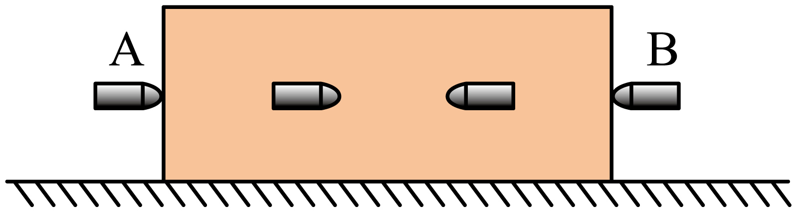

# Physics - 题目 866

**ID**: c2e6af0761754ebfa8d9eb0cd32bad26
**年级**: Grade 12
**难度**: Medium-Hard
**题型**: Multiple-choice

## 题目
如图所示，木块静止在光滑水平面上，子弹A、B从两侧同时水平射入木块，木块始终保持静止，子弹A射入木块的深度是B的3倍。​​​​​​​‌假设木块对子弹阻力大小恒定，A、B做直线运动且不会相遇，则A、B运动的过程中，下列说法正确的是（      ）

## 解答

1. A．以木块和子弹A、B组成的系统为研究对象，系统受合外力是零，则有系统的动量守恒，A错误；
2. BC．以木块和子弹A、B组成的系统为研究对象，取水平向右为正方向，由动量守恒定律可得 $m{{}_{{\rm{A}}}}v{{}_{{\rm{A}}}}-m{{}_{{\rm{B}}}}v{{}_{{\rm{B}}}}=0$ ，则有 $m{{}_{{\rm{A}}}}v{{}_{{\rm{A}}}}=m{{}_{{\rm{B}}}}v{{}_{{\rm{B}}}}$ ,，即子弹A的初动量与子弹B的初动量大小相等，由于木块始终保持静止，木块受合力是零，可知两子弹对木块的作用力大小相等，由牛顿第三定律可知，两子弹受木块的阻力大小相等，设为F_{f}，子弹射入木块的深度为d，由动能定理，对子弹A有 $-F{{}_{{\rm{f}}}}d{{}_{{\rm{A}}}}=0-E{{}_{{\rm{k}}{\rm{A}}}}$ ，可得 $F{{}_{{\rm{f}}}}d{{}_{{\rm{A}}}}=E{{}_{{\rm{k}}{\rm{A}}}}$ ，对子弹B有 $-F{{}_{{\rm{f}}}}d{{}_{{\rm{B}}}}=0-E{{}_{{\rm{k}}{\rm{B}}}}$ ，可得 $F{{}_{{\rm{f}}}}d{{}_{{\rm{B}}}}=E{{}_{{\rm{k}}{\rm{B}}}}$ ，由于 $d{{}_{{\rm{A}}}}=3d{{}_{{\rm{B}}}}$ ，则有两子弹初动能的关系为 $E{{}_{{\rm{k}}{\rm{A}}}}=3E{{}_{{\rm{k}}{\rm{B}}}}$ ，由动能公式可得 $E{{}_{{\rm{k}}{\rm{A}}}}=\frac {m{{}_{{\rm{A}}}^{2}}v{{}_{{\rm{A}}}^{2}}}{2m{{}_{{\rm{A}}}}}$ ， $E{{}_{{\rm{k}}{\rm{B}}}}=\frac {m{{}_{{\rm{B}}}^{2}}v{{}_{{\rm{B}}}^{2}}}{2m{{}_{{\rm{B}}}}}$ ，解得 $m{{}_{{\rm{B}}}}=3m{{}_{{\rm{A}}}}$ ，即子弹B的质量是子弹A的质量的3倍；由于 $m{{}_{{\rm{A}}}}v{{}_{{\rm{A}}}}=m{{}_{{\rm{B}}}}v{{}_{{\rm{B}}}}$ ，可得 $v{{}_{{\rm{A}}}}=3v{{}_{{\rm{B}}}}$ ，即子弹A的初速度大小是子弹B的初速度大小的3倍，B错误，C正确；
3. D．若子弹A向右射入木块，子弹A与木块组成的系统动量守恒，子弹A与木块相对静止时有共同的速度，由能量守恒定律可知，系统减少的机械能 $ΔE=F{{}_{{\rm{f}}}}d{{}_{{\rm{A}}}}{^{\prime }}<E{{}_{{\rm{k}}{\rm{A}}}}$ ，可得 $d{{}_{{\rm{A}}}}{^{\prime }}<d{{}_{{\rm{A}}}}$ ，子弹B再向左射入木块，由于子弹A、B与木块组成的系统动量守恒，由以上分析可知 $m{{}_{{\rm{A}}}}v{{}_{{\rm{A}}}}=m{{}_{{\rm{B}}}}v{{}_{{\rm{B}}}}$ ，则有系统的初动量是零，由动量守恒定律可知，最后A、B与木块都静止，子弹B射入木块运动中，由能量守恒定律可知，系统减少的机械能 $ΔE^{′}=F{{}_{{\rm{f}}}}d{{}_{{\rm{B}}}}{^{\prime }}>E{{}_{{\rm{k}}{\rm{B}}}}$ ，可得 $d{{}_{{\rm{B}}}}{^{\prime }}>d{{}_{{\rm{B}}}}$ ，由以上分析可知 $d{{}_{{\rm{A}}}}{^{\prime }}< 3d{{}_{{\rm{B}}}}{^{\prime }}$ ，D错误。选C。

## 知识点

**中文**:
  - 子弹-木块模型

**English**:
  - Bullet-Block Model

---
