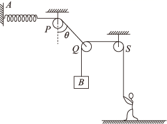

# Physics - 题目 1455

**ID**: c73aea3a5d7e45698eafcf79d33e1449
**年级**: Grade 12
**难度**: Medium-Hard
**题型**: Multiple-choice

## 题目
如图所示，轻质弹簧的一端固定于A点，另一端与轻绳相连，轻绳绕过定滑轮P与动滑轮Q的轴相连，另外一根轻绳一端悬挂重物B并绕过动滑轮Q及定滑轮S，由地面上某人拉着轻绳另一端，使整个系统处于静止状态，此时QS连线水平，PQ连线与竖直方向夹角为 $θ$ 。​​​​​​​‌若人加速向下拉动细绳移动一段较小的距离，滑轮均为光滑轻质滑轮，且可看作质点，弹簧始终在弹性限度之内，则在加速拉动的过程中与原静止状态相比（      ）

## 解答

1. 假设动滑轮位置不变，当人加速拉动时，绳子拉力增大，则绳子在动滑轮处的合力增大，所以动滑轮会沿合力方向即PQ方向向右下移动。最终稳定时，绳子QS处于倾斜状态，动滑轮比原位置低，动滑轮处的两段绳子的夹角变为钝角。因为滑轮处无摩擦，所以PQ是动滑轮处两段绳子夹角的角平分线，因为夹角增大，所以 $θ$ 变大，因为动滑轮下移了，所以弹簧伸长了，即弹簧弹力变大。因为 $θ$ 变大，所以动滑轮向右下移动，但不是沿PQ方向移动。
2. 故选B。

## 知识点

**中文**:
  - 图解法在动态平衡问题中的应用

**English**:
  - Graphical Method for Dynamic Equilibrium

---
