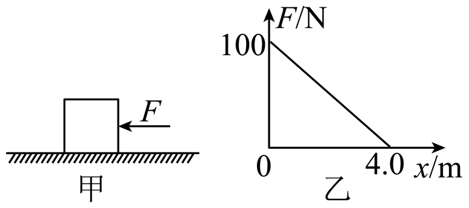

# Physics - 题目 193

**ID**: c995eac87aac406289e84b4d84761194
**年级**: Grade 12
**难度**: Medium-Hard
**题型**: Multiple-choice

## 题目
如图甲所示，质量为m＝5.0kg的物体静止在水平地面上，在水平推力F作用下开始运动，水平推力F随位移x变化的图像如图乙所示（x＝4.0 m后无推力存在）。​​​​​​​‌已知物体与地面之间的动摩擦因数μ＝0.50，取重力加速度g＝10m/s^{2}。下列选项正确的是（      ）

## 解答

1. 物体在水平方向受推力与摩擦力作用，由牛顿第二定律得 $F-{\rm μm}g=ma$ ，加速度 $a=\frac {F}{m}-μg$ ，由图乙所示图像可知，物体所受推力随位移的增加而减小，开始物体所受推力大于摩擦力，物体做加速运动，随推力F的减小，加速度a减小；当推力等于摩擦力时，合力为零，加速度为零；当推力小于摩擦力时物体所受合力方向与物体的速度方向相反，物体做减速运动，加速度a逐渐增大；撤去推力时物体所受合外力等于滑动摩擦力，物体加速度不变，做匀减速直线运动，直到速度为零，由以上分析可知，物体的加速度先减小后增大再不变，A错误；由图像可知，推力F随位移x变化的数学关系式为 $F=100-25x(0⩽x⩽4.0m)$ ，物体的速度最大时，加速度为零，此时有 $F={\rm μm}g$ ，解得 $x=\frac {100-{\rm μm}g}{25}=3{\rm{m}}$ ，即在距出发点3m位置时物体的速度达到最大，B正确；F-x图线与坐标轴围成图形的面积等于推力对物体做功，设物体的最大速度为v_{m}，由图乙所示图像可知，物体速度最大时，推力对物体做功 $W=\frac {1}{2}\times (100+25)\times 3{\rm{J}}=187.5{\rm{J}}$ ，从物体开始运动到速度最大过程，对物体，由动能定理得 $W-{\rm μm}gx=\frac {1}{2}mv{{}_{m}}{^{2}}-0$ ，代入数据解得 $v{{}_{m}}=3\sqrt {5}{\rm{m}}{\rm{/}}{\rm{s}}{\rm ，C}$ 错误；由F～x图像可知，推力对物体做的功等于图线与坐标轴围成的面积，即 $W=\frac {1}{2}Fx=\frac {1}{2}\times 100\times 4.0{\rm{J}}=200{\rm{J}}$ ，对物块运动的整个过程，根据动能定理可得 $W-{\rm μm}gx{{}_{\max }}=0$ ，代入数据解得 $x{{}_{\max }}=8{\rm{m}}{\rm ，D}$ 错误。

## 知识点

**中文**:
  - 应用动能定理求解与图像相关的动能问题

**English**:
  - Graph-related Kinetic Energy Problems

---
