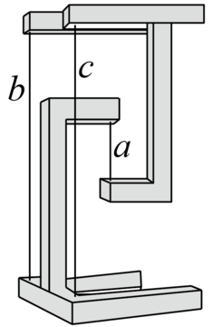

# Physics - 题目 1539

**ID**: d19e61a50ffc45c1a7f88f23f35d32b1
**年级**: Grade 12
**难度**: Medium-Hard
**题型**: Multiple-choice

## 题目
如图所示，两个完全相同的木模质量均为m，通过三根轻质竖直细线对称连接，放在水平面上呈“互”字型静置，上方木模呈现悬浮效果，这是利用了建筑学中的“张拉整体”的结构原理。​​​​​​​‌细线a、b、c上的张力大小分别用Fa、Fb、Fc表示，水平面所受的压力大小为F_{N}，重力加速度大小为g。下列关系式正确的是（      ）

## 解答

1. 整体受力分析，由平衡条件得
2. $F{{}_{{\rm{N}}}}=2mg$
3. 由对称性可知
4. $F{{}_{b}}=F{{}_{c}}$
5. 对上方木模受力分析有
6. $F{{}_{a}}=mg+F{{}_{c}}+F{{}_{b}}$
7. 则
8. $F{{}_{a}}>mg$ ， $F{{}_{a}}\ne F{{}_{b}}+F{{}_{c}}$
9. 故选A。

## 知识点

**中文**:
  - 受力分析

**English**:
  - Force Analysis

---
