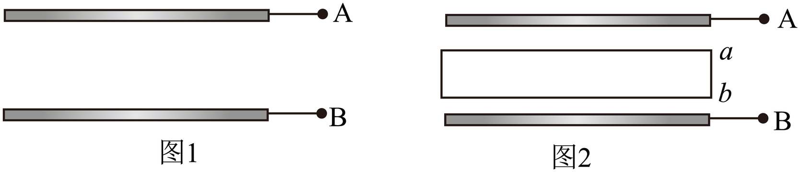

# Physics - 题目 1547

**ID**: d968d7f902324aac9cab292e8fb334d1
**年级**: Grade 12
**难度**: Medium-Hard
**题型**: Multiple-choice

## 题目
如图1所示，面积均为S的正对平行金属板A、B构成电容器，充电后与电源断开，A板带正电荷Q，板间距为d。​​​​​​​‌现将厚度为h、面积为S的铜板置于A、B正中间，铜板上表面用a表示，下表面用b表示，如图2所示。设空气的相对介电常数ε_{r}=1，静电力常量为k，则下列说法不正确的是（      ）

## 解答

1. 根据题意知 $ε{{}_{{\rm{r}}}}=1$ ，平行板电容器的电容 $C=\frac {ε{{}_{{\rm{r}}}}S}{4πkd}$ ，电容的定义式 $C=\frac {Q}{U}$ ，匀强电场 $E=\frac {U}{d}$ ，联立可得 $E=\frac {4πkQ}{ε{{}_{{\rm{r}}}}S}=\frac {4πkQ}{S}$ ，故A正确，不符合题意；插入铜板后相当于两个电容器串联，设每个电容器电容为C，则 $C=\frac {ε{{}_{{\rm{r}}}}S}{4πk\cdot \frac {d-h}{2}}=\frac {ε{{}_{{\rm{r}}}}S}{2πk(d-h)}$ ，串联总电容 $C{{}_{2}}=\frac {C\cdot C}{C+C}=\frac {C}{2}=\frac {ε{{}_{{\rm{r}}}}S}{4πk(d-h)}$ ，插入铜板前电容器电容 $C{{}_{1}}=\frac {ε{{}_{{\rm{r}}}}S}{4πkd}$ ，由 $C=\frac {Q}{U}$ 得 $\frac {U{{}_{1}}}{U{{}_{2}}}=\frac {C{{}_{2}}}{C{{}_{1}}}=\frac {d}{d-h}$ ，故B错误，符合题意；铜板置于A、B正中间处于静电平衡状态，由处于静电平衡状态导体的特点可知，铜板内部场强处处为0，故C正确，不符合题意；由A项分析可知，平行金属板A、B正中心处的电场强度 $E=\frac {4πkQ}{S}$ ，铜板内部场强处处为0，铜板中心处 $E{{}_{合}}=E+E^{′}=0$ ，由此得铜板上下表面感应电荷在铜板中心处产生的场强 $E^{′}=-E=-\frac {4πkQ}{S}$ ，方向竖直向上，由场强叠加原理得铜板下表面b的感应电荷在铜板中心处产生的场强为 $E{{}_{1}}=\frac {1}{2}E^{′}=-\frac {2πkQ}{S}$ ，负号表示方向竖直向上，故D正确，不符合题意。

## 知识点

**中文**:
  - 平行板电容器电容大小及其影响因素

**English**:
  - Factors Affecting Capacitance of Parallel Plate Capacitors

---
