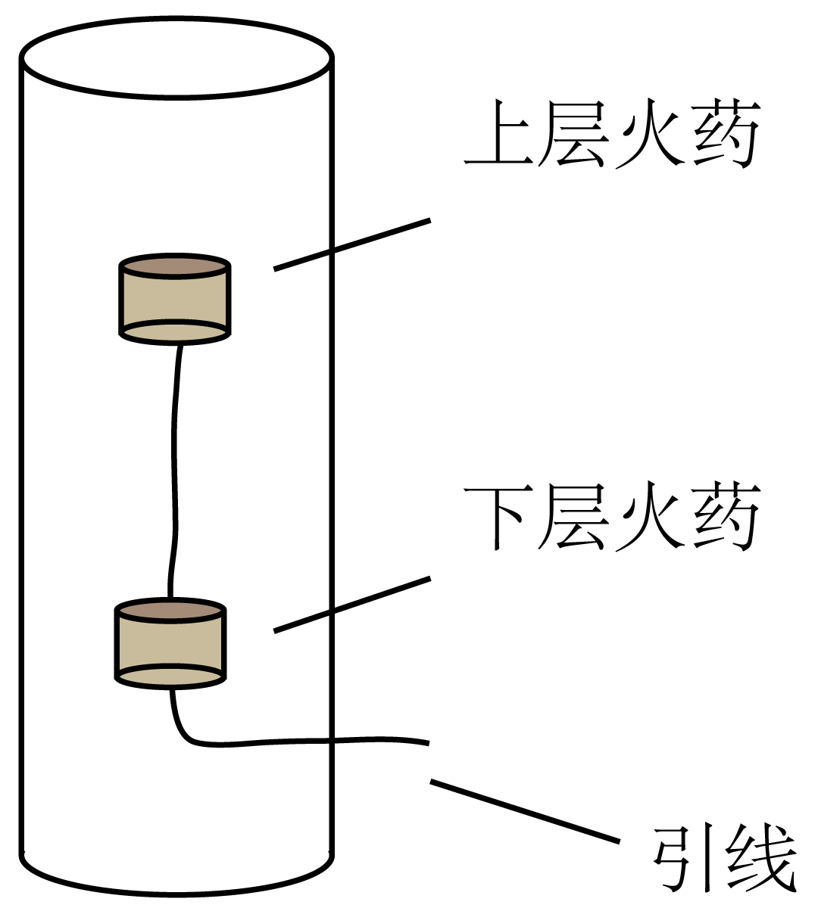

# Physics - 题目 699

**ID**: dc69a95cf9d64bd39113dec6460f9dbd
**年级**: Grade 12
**难度**: Medium-Hard
**题型**: Multiple-choice

## 题目
如图所示质量为 $m$ 的某型号双响爆竹的结构简化图，其内部结构分上、下两层，分别装载火药。​​​​​​​‌某次在一水平地面上燃放测试中，点燃引线，下层火药被瞬间引燃后，爆竹获得了竖直升空的初始速度。当爆竹上升到最大高度 $h$ 处时，上层火药恰好被引燃，爆竹瞬间分裂成质量之比为 $1：2$ 的P、Q两部分。若P、Q均沿水平方向飞出，落地点间的水平距离为 $L$ ，不计空气阻力及爆竹爆炸前后的质量变化，重力加速度为g。下列说法正确的是（      ）

## 解答

1. 设下层火药被引燃后爆竹的速度大小为v，则 $v{^{2}}=2gh$ ，下层火药被引燃后爆竹获得的动量为 $p=mv$ ，解得 $p=m\sqrt {2gh}{\rm ，A}$ 错误；引燃上层火药后两部分向相反的方向做平抛运动，竖直方向有 $h=\frac {1}{2}gt{^{2}}$ ，水平方向有 $L=v{{}_{1}}t+v{{}_{2}}t$ ，上层火药燃爆时，水平方向动量守恒，取质量较小部分P获得的速度方向为正方向，则有 $0=\frac {1}{3}mv{{}_{1}}-\frac {2}{3}mv{{}_{2}}$ ，解得P、Q各自获得的速度大小分别为 $v{{}_{1}}=\frac {L}{3}\sqrt {\frac {2g}{h}}$ ， $v{{}_{2}}=\frac {L}{3}\sqrt {\frac {g}{2h}}{\rm ，B}$ 错误；P、Q着地前瞬间竖直方向的速度大小均为 $v{{}_{y}}=\sqrt {2gh}{\rm ，P}$ 、Q着地前瞬间的速度大小分别为 $v{{}_{1}}{^{^{′}}}=\sqrt {v{{}_{y}}{^{2}}+v{{}_{1}}{^{2}}}=\sqrt {2gh+\frac {2gL{^{2}}}{9h}}$ ， $v{{}_{2}}{^{^{′}}}=\sqrt {v{{}_{y}}{^{2}}+v{{}_{2}}{^{2}}}=\sqrt {2gh+\frac {gL{^{2}}}{18g}}$ ，因 $v{{}_{1}}{^{2}}=4v{{}_{2}}{^{2}}$ ，所以 $v{{}_{1}}{^{^{′}}}:v{{}_{2}}{^{^{′}}}\ne 2:1{\rm ，C}$ 错误；上层火药燃爆后爆竹获得的机械能为 $E{{}_{1}}=\frac {1}{2}\times \frac {1}{3}mv{{}_{1}}{^{2}}+\frac {1}{2}\times \frac {2}{3}mv{{}_{2}}{^{2}}$ ，下层火药燃爆后爆竹获得的机械能为 $E{{}_{2}}=mgh$ ，解得 $\frac {E{{}_{1}}}{E{{}_{2}}}=\frac {L{^{2}}}{18h{^{2}}}{\rm ，D}$ 正确。

## 知识点

**中文**:
  - 爆炸问题

**English**:
  - Explosion Problems

---
