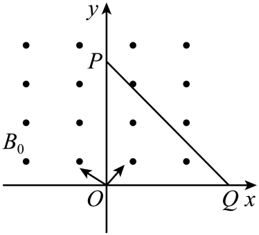

# Physics - 题目 378

**ID**: e02cee3cda8944aaa2713722cb2086fa
**年级**: Grade 12
**难度**: Medium-Hard
**题型**: 非选择题

## 题目
如图所示，在xOy平面内，在 $y>0$ 的区域内有垂直平面向外的匀强磁场，磁感应强度大小为B_{0}，第一象限有一与x轴成45°角倾斜放置的挡板PQ，P、Q两点在坐标轴上，其中P点的纵坐标为（ $\sqrt {2}$ +1）a，大量相同的质量为m、电荷量为+q的带电粒子，从O点以大小相同、方向不同的速度平行纸面射入第一、二象限，不计粒子间的相互作用和重力。​​​​​​​‌其中沿 $-x$ 方向入射的粒子运动轨迹恰好与挡板相切。（1）求带电粒子的速度大小；（2）求挡板上有粒子打中区域的长度l；（3）若磁场的磁感应强度大小可调，要使所有粒子均不能打在挡板上，求磁场的磁感应强度大小需满足的条件。

## 解答

1. （1）根据题意，画出沿 $-x$ 方向入射的粒子的运动轨迹，如图所示
2. 
3. 由图根据几何关系有
4. $\left ({\sqrt {2}+1}\right )R=\left ({\sqrt {2}+1}\right )a$
5. 解得
6. $R=a$
7. 粒子进入磁场，洛伦兹力提供向心力有
8. $qv{{}_{0}}B{{}_{0}}=m\frac {v{{}_{0}^{2}}}{R}$
9. 联立解得
10. $v{{}_{0}}=\frac {qB{{}_{0}}a}{m}$
11. （2）设粒子能打到挡板上的最高处为挡板上的M点，当粒子沿 $+y$ 方向入射时，轨迹恰好与PQ相切与F点，F点为最低点，如图所示
12. 
13. 去PQ的中点G，根据几何关系和题意可知
14. $OM=2R=2a$ ， $OG=\left ({1+\frac {\sqrt {2}}{2}}\right )a$
15. 则
16. $MG=\sqrt {OM{^{2}}-OG{^{2}}}=\sqrt {\frac {10-4\sqrt {2}}{2}}a$ ， $FG=QG-R=\frac {\sqrt {2}}{2}a$
17. 挡板上有粒子打中区域的长度为
18. $l=MG+FG=\frac {\sqrt {2}+\sqrt {10+4\sqrt {2}}}{2}a$
19. （3）根据 $Bv{{}_{0}}q=m\frac {v{{}_{0}^{2}}}{R{{}_{1}}}$ 可知
20. $R{{}_{1}}=\frac {mv{{}_{0}}}{qB}$
21. 在粒子的比荷和速度大小不变的情况下，磁感应强度越大，半径越小，如图所示
22. 
23. 要想粒子能够打在挡板上，则OG为直径的圆的轨迹半径最小，此时的磁感应强度B最大，根据几何关系可知
24. $R{{}_{1}}=\frac {1}{2}OG=\frac {\sqrt {2}+2}{4}a$
25. 联立解得
26. $B=\left ({4-2\sqrt {2}}\right )B{{}_{0}}$
27. 即要使所有粒子均不能打在挡板上，磁感应强度大小满足
28. $B>\left ({4-2\sqrt {2}}\right )B{{}_{0}}$

## 知识点

**中文**:
  - 带电粒子在匀强磁场中的运动
  - 带电粒子的运动半径和周期公式及其简单应用

**English**:
  - Motion of Charged Particles in Uniform Magnetic Field
  - Radius and Period Formulas and Applications

---
