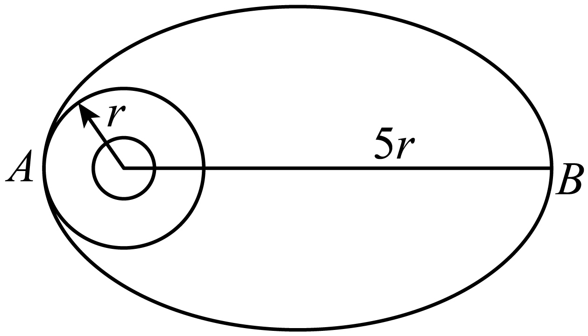

# Physics - 题目 468

**ID**: e50c1343654b44cd95ca92a4f47d8e72
**年级**: Grade 12
**难度**: Medium-Hard
**题型**: Multiple-choice

## 题目
如图所示为探月卫星从圆轨道变轨到椭圆轨道的示意图， $\mathrm{A}$ 、 $B$ 两点为椭圆轨道上的近月点和远月点，近月点到月心距离为 $r$ ，远月点到月心距离为 $5r$ 。​​​​​​​‌规定无穷远处引力势能为零，引力势能的公式为 $E{{}_{{\rm{p}}}}=-G\frac {Mm}{R}$ ，其中 $G$ 为引力常量， $M$ 为中心天体的质量， $m$ 为卫星的质量， $R$ 为两者中心之间的距离。已知月球质量为 $M{{}_{0}}$ ，下列说法正确的是（      ）

## 解答

1. 根据开普勒第三定律可得 $\frac {r{^{3}}}{T{{}_{圆}^{2}}}=\frac {(\frac {r+5r}{2}){^{3}}}{T{{}_{椭圆}^{2}}}$ ，解得 $\frac {T{{}_{圆}}}{T{{}_{椭圆}}}=\sqrt {(\frac {r}{3r}){^{3}}}=\frac {1}{3\sqrt {3}}{\rm ，A}$ 错误；卫星在圆形轨道变轨到椭圆轨道时需要在A点加速，加速过程中，外力对卫星做功，卫星的机械能增大，卫星在椭圆轨道上的机械能大于在圆轨道上的机械能，B错误；根据开普勒第二定律可知，卫星与月球中心的连线在相等的时间内扫过的面积相等，则有 $\frac {1}{2}rv{{}_{A}}t=\frac {1}{2}\centerdot 5rv{{}_{B}}t$ ，解得 $v{{}_{A}}:v{{}_{B}}=5:1{\rm ，C}$ 错误；卫星在椭圆轨道上运行时，机械能守恒，则有 $\frac {1}{2}mv{{}_{A}^{2}}-\frac {GM{{}_{0}}m}{r}=\frac {1}{2}mv{{}_{B}^{2}}-\frac {GM{{}_{0}}m}{5r}$ ，结合上述结论 $v{{}_{A}}:v{{}_{B}}=5:1$ ，联立解得 $v{{}_{A}}=\sqrt {\frac {5GM{{}_{0}}}{3r}}{\rm ，D}$ 正确。

## 知识点

**中文**:
  - 卫星变轨与对接问题

**English**:
  - Satellite Orbit Change and Docking

---
