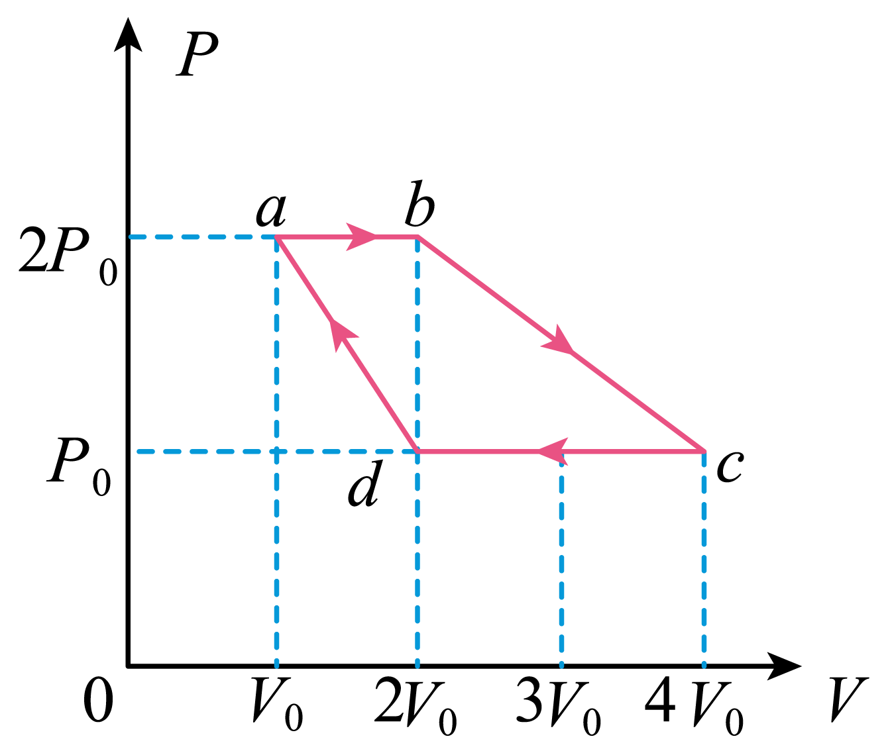

# Physics - 题目 657

**ID**: ecdcf10fe60c43f28d48c78e70b098c2
**年级**: Grade 12
**难度**: Medium-Hard
**题型**: Multiple-choice

## 题目
一定质量的理想气体从状态a开始，经过如图所示a→b→c→d的四个过程，最后回到初始状态a，则下列判断正确的是（      ）​​​​​​​‌

## 解答

1. 根据理想气体状态方程 $\frac {PV}{T}=C$ ，可知 $T{{}_{b}}=T{{}_{c}}$ ， $T{{}_{a}}=T{{}_{d}}$ ，所以， $b$ 、 $c$ 状态的内能相等； $a$ 、 $d$ 状态的内能相等。所以a→b过程中气体内能的增加量等于c→d过程中气体内能的减少量，A正确；a→b过程中气体对外做功为 $W{{}_{1}}=2P{{}_{0}}\cdot {\rm{Δ}}V=2P{{}_{0}}V{{}_{0}}{\rm ，\mathit{c}}$ →d过程中气体对外做功为 $W{{}_{2}}=P{{}_{0}}\cdot {\rm{Δ}}V^{′}=2P{{}_{0}}V{{}_{0}}$ ，根据热力学第一定律 ${\rm{Δ}}U=W+Q$ ，由A选项可知，a→b过程中气体内能的增加量等于c→d过程中气体内能的减少量，又因为 $W{{}_{1}}=W{{}_{2}}$ ，所以 $Q{{}_{1}}=Q{{}_{2}}{\rm ，B}$ 错误；b→c过程中，由数学推理可知b点： $PV=4P{{}_{0}}V{{}_{0}}{\rm ，\mathit{c}}$ 点： $PV=4P{{}_{0}}V{{}_{0}}{\rm ，\mathit{bc}}$ 的中点： $PV=\frac {9}{2}P{{}_{0}}V{{}_{0}}$ ，可知b→c过程中， $PV$ 先增大后减小，则可以根据理想气体状态方程 $\frac {PV}{T}=C$ ，得到 $T$ 先增大后减小；c→d过程中，压强不变，体积逐渐减小，根据理想气体状态方程 $\frac {PV}{T}=C$ ，可知温度逐渐减小；所以，b→c→d过程中气体的温度先升高后降低，C错误； $P-V$ 图线的面积表示做功，由图可知，a→b→c过程中气体对外做的功大于c→d→a过程中外界对气体做的功，D错误。

## 知识点

**中文**:
  - 气体的p-V图像问题

**English**:
  - p-V Graph Problems

---
