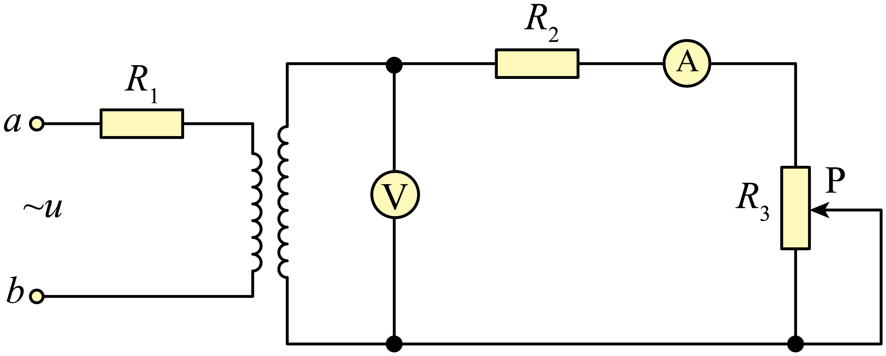

# Physics - 题目 702

**ID**: ef919b36c5924aa8ab94f7c318e69f65
**年级**: Grade 12
**难度**: Medium-Hard
**题型**: Multiple-choice

## 题目
如图所示为模拟远距离输电的部分测试电路。​​​​​​​‌a、b端接电压有效值恒定的正弦交流电源，理想变压器的原、副线圈匝数比为 ${\rm \mathit{k}，}\frac {\sqrt {2}}{2}<k<1$ ，滑动变阻器的最大阻值为 $R{{}_{0}}$ ，定值电阻 $R{{}_{1}}=R{{}_{2}}=R{{}_{0}}$ ，电流表、电压表均为理想电表，其示数分别用I和U表示。当滑动变阻器 $R{{}_{3}}$ 的滑片P从最下端向最上端滑动过程中，电流表、电压表示数变化量分别用 $ΔI$ 和 $\Delta U$ 表示。下列说法正确的是（      ）

## 解答

1. 根据变压器的原理可得 $\frac {U{{}_{1}}}{U{{}_{2}}}=k$ ， $\frac {I{{}_{2}}}{I{{}_{1}}}=k$ ，可得 $U{{}_{1}}=kU{{}_{2}}$ ， $I{{}_{1}}=\frac {I{{}_{2}}}{k}$ ，原线圈电路中有 $U{{}_{0}}=U{{}_{1}}+I{{}_{1}}R{{}_{1}}$ ，在副线圈电路中有 $U{{}_{2}}=I{{}_{{{2}}}}\left ({R{{}_{2}}+R{{}_{3}}}\right )$ ，联立可得 $U{{}_{0}}=U{{}_{2}}\left [k+\frac {R{{}_{{{1}}}}}{k\left ({R{{}_{2}}+R{{}_{3}}}\right )}\right ]$ ，当滑片P从最下端向最上端滑动过程中，电阻 $R{{}_{3}}$ 阻值减小，电源电压 $U{{}_{0}}$ 不变，可知 $U{{}_{2}}$ 减小，即电压表的示数 $U$ 减小，A错误；由A项分析可得 $U{{}_{0}}=kU{{}_{2}}+\frac {I{{}_{2}}}{k}R{{}_{1}}$ ，变形得 $U{{}_{2}}=\frac {U{{}_{{{0}}}}}{k}-\frac {R{{}_{1}}}{k{^{2}}}I{{}_{2}}$ ，则有 $\left |{\frac {\Delta U}{\Delta I}}\right |=\frac {R{{}_{1}}}{k{^{2}}}$ ，即 $R{{}_{1}}=k{^{2}}\left |{\frac {ΔU}{ΔI}}\right |{\rm ，B}$ 正确；由能量守恒定律可得 $I{{}_{1}}U{{}_{0}}=I{{}_{1}^{2}}R{{}_{1}}+I{{}_{2}^{2}}\left ({R{{}_{2}}+R{{}_{3}}}\right )$ ，可得 $I{{}_{1}}=\frac {U{{}_{0}}}{R{{}_{1}}+k{^{2}}\left ({R{{}_{2}}+R{{}_{3}}}\right )}$ ，副线圈回路消耗的功率 $P=I{{}_{2}^{2}}\left ({R{{}_{2}}+R{{}_{3}}}\right )=k{^{2}}I{{}_{{{1}}}^{2}}\left ({R{{}_{2}}+R{{}_{3}}}\right )$ ，把 $I{{}_{1}}$ 代入得 $P=\frac {U{{}_{0}^{2}}\cdot k{^{2}}\left ({R{{}_{2}}+R{{}_{3}}}\right )}{\left [R{{}_{1}}+k{^{2}}\left ({R{{}_{2}}+R{{}_{3}}}\right )\right ]{^{2}}}=\frac {U{{}_{{{0}}}^{{{2}}}}}{\frac {\left ({k{^{2}}\left ({R{{}_{2}}+R{{}_{3}}}\right )-R{{}_{1}}}\right ){^{2}}}{k{^{2}}\left ({R{{}_{2}}+R{{}_{3}}}\right )}+4R{{}_{1}}}$ ，可知当 $k{^{2}}\left ({R{{}_{2}}+R{{}_{3}}}\right )=R{{}_{1}}$ 时，即 $k{^{2}}\left ({R{{}_{0}}+R{{}_{3}}}\right )=R{{}_{0}}$ 时副线圈输出功率增大；由题知 $\frac {\sqrt {2}}{2}<k<1$ ，则有 $\frac {1}{2}<k{^{2}}<1$ ，当滑片P从最下端向最上端滑动过程中，电阻 $R{{}_{3}}$ 阻值由 $R{{}_{0}}$ 减小为0，可知 $k{^{2}}\left ({R{{}_{0}}+R{{}_{3}}}\right )$ 由大于 $R{{}_{0}}$ 减小到小于 $R{{}_{0}}$ ，所以副线圈输出功率并不是一直增大，C错误；当向上调节滑动变阻器的滑片P时，副线圈的总电阻减小，所以回路中的电流增大，电源的电压不变，所以电源的输出功率一定增大，则D错误。

## 知识点

**中文**:
  - 电能的输送

**English**:
  - Transmission of Electrical Energy

---
