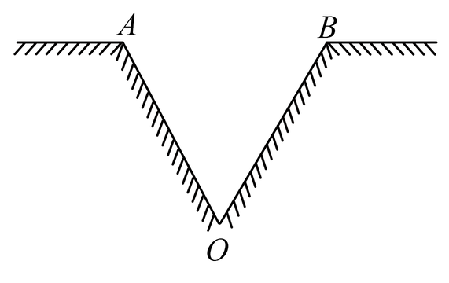

# Physics - 题目 2234

**ID**: f325cdd24dc84d0c83b9325ff5c2c2eb
**年级**: Grade 12
**难度**: Medium-Hard
**题型**: Multiple-choice

## 题目
如图所示，一横截面为三角形的水渠 $AOB$ ， $AB$ 在同一水平面上，且 $AB=AO=BO=L$ ，从A点以不同的初速度水平抛出小石子，小石子落地后不反弹。​​​​​​​‌不计空气阻力，重力加速度大小为g。下列说法正确的是（      ）

## 解答

1. A．落到 $AO$ 边上的小石子，设 $AO$ 斜面倾角为 $θ$ ，由平抛运动的规律知
2. ${\tan}θ=\frac {y}{x}=\frac {\frac {1}{2}gt{^{2}}}{v{{}_{0}}t}=\frac {gt}{2v{{}_{0}}}$
3. 设落在 $AO$ 斜面上的小石子落地时的速度方向与水平方向的夹角为 $α$ ，则
4. ${\tan}α=\frac {v{{}_{y}}}{v{{}_{0}}}=\frac {gt}{v{{}_{0}}}=2{\tan}θ$
5. 所以所有落到 $AO$ 边上的小石子落地时的速度方向与水平方向的夹角相等，故A错误；
6. B．初速度越大的石子，飞行距离越远，设最远落在O点的石子用时为t，由平抛运动的规律知
7. $\frac {\sqrt {3}}{2}L=\frac {1}{2}gt{^{2}}$ ， $\frac {1}{2}L=v{{}_{0}}t$
8. 解得
9. $v{{}_{0}}=\frac {1}{2}\sqrt {\frac {gL}{\sqrt {3}}}$
10. B选项所给速度小于 $v{{}_{0}}$ ，故B正确；
11. C．将小石子的速度分解为沿AO方向的 $v{{}_{x}}$ 和垂直AO方向的 $v{{}_{y}}$ ，将小石子的加速度分解为沿AO方向的 $a{{}_{x}}$ 和垂直AO方向的 $a{{}_{y}}$ 则有
12. $v{{}_{x}}=v{{}_{0}}{\cos}θ$ ， $v{{}_{y}}=v{{}_{0}}\sin θ$
13. $a{{}_{x}}=g\sin θ$ ， $a{{}_{y}}=g{\cos}θ$
14. 离斜面最远时
15. $0=v{{}_{y}}-a{{}_{y}}t$
16. 联立解得最远距离为
17. $y=\frac {1}{2}a{{}_{y}}t{^{2}}=\frac {\sqrt {3}}{16}L$
18. 故C错误；
19. D．若水平抛出，并垂直撞击在OB边，则速度偏角满足
20. ${\tan}θ=\frac {v{{}_{0}}}{gt}=\sqrt {3}$
21. 由平抛运动的规律知
22. $y=\frac {1}{2}gt{^{2}}$ ， $x=v{{}_{0}}t$
23. 由几何关系可知
24. $\frac {y}{{\tan}θ}+2\frac {L\sin θ-y}{{\tan}θ}=x$
25. 联立可得
26. $v{{}_{0}}=\sqrt {\frac {6\sqrt {3}gL}{7}}$
27. 故D错误。
28. 故选B。

## 知识点

**中文**:
  - 平抛运动与斜面、圆轨道相结合问题

**English**:
  - Horizontal Projectile on Inclined Planes and Circular Tracks

---
