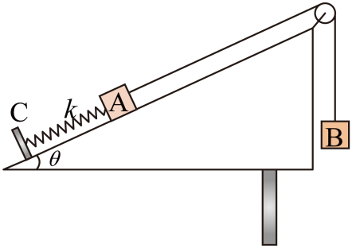

# Physics - 题目 747

**ID**: f4be8f2add49461291af9d3df2242141
**年级**: Grade 12
**难度**: Medium-Hard
**题型**: Multiple-choice

## 题目
如图所示，倾角 $θ=30{}^\circ $ 的光滑固定斜面上，轻质弹簧下端与固定板C相连，另一端与物体A相连.A上端连接一轻质细线，细线绕过光滑的定滑轮与物体B相连且始终与斜面平行。​​​​​​​‌开始时托住B，A处于静止状态且细线恰好伸直，然后由静止释放B。已知A、B的质量均为m，弹簧的劲度系数为k，重力加速度为g，B始终未与地面接触。从释放B到B第一次下落至最低点的过程中，下列说法中正确的是（      ）

## 解答

1. A．刚释放物体B时，以A、B组成的系统为研究对象，有 $mg=（m+m）a$ ，解得 $a=\frac {1}{2}g$ ，对B研究 $mg-T=ma$ ，解得 $T=\frac {1}{2}mg$ ，物体A受到细线的拉力大小为 $\frac {1}{2}mg$ ，A错误；
2. B．手拖住物块B时，物块A静止，设此时弹簧的压缩量为 $x{{}_{0}}$ ，对物块A根据平衡条件可得 $kx{{}_{0}}=mg{\sin}θ$ ，解得 $x{{}_{0}}=\frac {mg}{2k}$ ，当物体A上升过程中，当A和B整体的加速度为0时速度达到最大值，此时细线对A的拉力大小刚好等于B的重力，设此时弹簧的伸长量为 $x{{}_{1}}$ ，则 $mg-kx{{}_{1}}-mg{\sin}θ=0$ ，解得 $x{{}_{1}}=\frac {mg}{2k}$ ，所以此时弹簧的弹性势能与初始位置时相同，对A、B和弹簧组成的系统，只有重力和弹簧弹力做功，所以系统的机械能守恒，根据机械能守恒定律得 $mg（x{{}_{0}}+x{{}_{1}}）-mg（x{{}_{0}}+x{{}_{1}}）{\sin}θ=\frac {1}{2}\times 2mv{{}_{{\rm{m}}}^{2}}$ ，解得 $v{{}_{{\rm{m}}}}=\sqrt {\frac {mg{^{2}}}{2k}}$ ，B正确；
3. C．当B下落至最低点时，AB整体减少的机械能最大，转化为弹簧的弹性势能最多，所以此时弹簧具有最大的弹性势能，C错误；
4. D．当B下落至最低点时，此时A上升到最高位置，根据对称性可知B产生的加速度大小也为 $a^{′}=a=\frac {1}{2}g$ ，对B受力分析，根据牛顿第二定律可知 $T^{′}-mg=ma^{′}$ ，解得 $T^{′}=\frac {3}{2}mg$ ，AB整体研究，设此时弹簧弹力为F，则 $F+mg{\sin}θ-mg=（m+m）a^{′}$ ，解得 $F=\frac {3}{2}mg$ ，对A研究，A受到弹簧拉力、重力和绳子的拉力，则 $F{{}_{合}}=mg{\sin}θ+F-T^{′}=\frac {1}{2}mg$ ，D错误。选B。

## 知识点

**中文**:
  - 其他连接体问题中机械能守恒定律的应用

**English**:
  - Other Connected Body Problems

---
