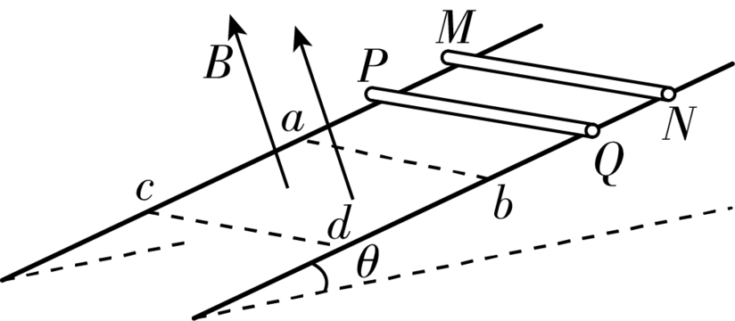

# Physics - 题目 2077

**ID**: f8b67cede5c24a9fa631612ee5def66a
**年级**: Grade 12
**难度**: Medium-Hard
**题型**: 选择题：本题共8小题，每小题6分，共48分。在每小题给出的四个选项中，第1～5题只有一项符合题目

## 题目
如图，两条光滑平行金属导轨固定，所在平面与水平面夹角为θ，导轨电阻忽略不计。​​​​​​​‌虚线ab、cd均与导轨垂直，在ab与cd之间的区域存在垂直于导轨所在平面的匀强磁场。将两根相同的导体棒PQ、MN先后自导轨上同一位置由静止释放，两者始终与导轨垂直且接触良好。已知PQ进入磁场时加速度恰好为零。从PQ进入磁场开始计时，到MN离开磁场区域为止，流过PQ的电流随时间变化的图像可能正确的是（      ）

## 解答

1. 本题借用双杆模型考查单杆切割问题。两导体棒从同一位置由静止释放，进入磁场的速度大小相同，设为v，PQ刚进入磁场时刚好做匀速运动，则mgsinθ＝F，F＝BI_{1}l，I_{1}＝ $\frac {Blv}{R}$ ，则mgsinθ＝ $\frac {B{^{2}}l{^{2}}v}{R}$ ，从PQ进磁场到MN出磁场的过程中，可能的情况有两种：第一种情况是PQ在磁场中运动时，MN还没有进入磁场，等PQ出了磁场后，MN再进入磁场，这种情况PQ和MN分别都是在磁场中做匀速直线运动，产生的感应电流大小相等，但是回路中电流的方向相反，A正确，B错误；第二种情况是PQ出磁场之前，MN已经进入磁场，MN刚进磁场时，由于两根导体棒速度大小相同，回路磁通量变化率为零，即感应电动势为零，电流为零，两棒均以a＝gsinθ的加速度做加速运动，当PQ出磁场后，MN在磁场中切割磁感线，产生感应电流，此时切割磁感线的速度大于刚进入磁场时的速度，产生的电流大于PQ刚进磁场时的电流，MN受到的合外力沿导轨向上，BI′l－mgsinθ＝ma，I′＝ $\frac {Blv^{′}}{R}$ ，MN做加速度减小的减速运动，PQ中的感应电流大小逐渐减小，方向与之前相反，I－t图像的斜率逐渐减小，C错误，D正确。
2. 一题多解：由题可知，感应电流大小为I_{1}时，导体棒所受的安培力的大小与导体棒重力沿导轨斜向下的分力大小相等，当感应电流大小不是此值时，安培力的大小会发生变化，破坏平衡状态，导致切割磁感线的导体棒速度发生变化，从而导致感应电流发生变化，由此可知B、C错误，本题为多选，故A、D符合题意。

## 知识点

**中文**:
  - 双杆模型

**English**:
  - Double Rod Model

---
