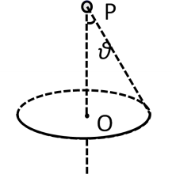

# Physics - 题目 198

**ID**: fc15a3e8aeb241f9915241be5646ee7c
**年级**: Grade 12
**难度**: Medium-Hard
**题型**: Multiple-choice

## 题目
如图，水平面上有一均匀带电圆环，带电量为+Q，其圆心为O点。​​​​​​​‌有一带电量+q，质量为m的小球恰能静止在O点正上方的P点。OP间距为L，P与圆环上任一点的连线与PO间的夹角为θ。P点场强大小为（      ）

## 解答

1. ABCD.由微元法分析
2. 
3. 选取圆环上某一点计算在P点竖直方向上的场强为
4. $E{{}_{0}}=\frac {kΔQ{\cos}θ}{\left ({\frac {L}{{\cos}θ}}\right ){^{{\rm{2}}}}}$
5. 圆环上各点累加可得
6. $E=\frac {kQ{\cos}{^{{\rm{3}}}}θ}{L{^{{\rm{2}}}}}$
7. 由受力分析可知
8. $mg=qE$
9. 解得
10. $E=\frac {mg}{q}$
11. 故C正确ABD错误。
12. 故选C。

## 知识点

**中文**:
  - 非点电荷的电场强度的计算与叠加

**English**:
  - Calculation and Superposition of Non-Point Charge Fields

---
