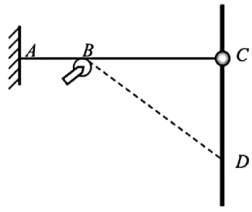

# Physics - 题目 1317

**ID**: fe3ed1f6d4844bd08d3867aecfa1e3cd
**年级**: Grade 12
**难度**: Medium-Hard
**题型**: Multiple-choice

## 题目
如图，弹性轻绳原长为L，一端固定于A点，另一端跨过光滑定滑轮B与穿过竖直杆的球在C处连接，球的质量为m。​​​​​​​‌此时ABC在同一水平线上，其中AB=L，弹性绳中弹力大小恰为mg。小球从C点由静止开始滑到D点时速度恰好为零，球与杆间的动摩擦因数 $μ=0.5$ ，弹性轻绳上弹力F的大小与其BC段伸长量x满足F=kx。则小球（      ）

## 解答

1. 小球运动到C、D间任意位置P时，设 $BP=x$ 、 $BC=x{{}_{0}}$ ，受力分析如图所示
2. 
3. P处有 $F{{}_{{\rm{N}}}}=kx\sin θ$ ，由几何关系知 $x\sin θ=x{{}_{0}}$ ，解得 $F{{}_{{\rm{N}}}}=kx\sin θ=kx{{}_{0}}$ ，依题意可知，C处满足 $kx{{}_{0}}=mg$ ，根据 $F{{}_{{\rm{f}}}}=μF{{}_{{\rm{N}}}}$ ，可得 $F{{}_{{\rm{f}}}}=\frac {1}{2}mg$ ，即从C到D与杆之间的滑动摩擦力不变，C错误；设CD间的距离为h，根据动能定理 $mgh-F{{}_{{\rm{f}}}}h+W{{}_{弹}}=0$ ，解得 $W{{}_{弹}}=-\frac {1}{2}mgh$ ，根据功能关系可知，弹性绳的弹性势能变化量为 ${\rm{Δ}}E{{}_{{\rm{p}}}}=-W{{}_{弹}}=\frac {1}{2}mgh$ ，又因为 ${\rm{Δ}}E{{}_{{\rm{p}}}}=\frac {1}{2}k(\sqrt {x{{}_{0}^{2}}+h{^{2}}}){^{2}}-\frac {1}{2}kx{{}_{0}^{2}}$ ，联立可得 $kh=mg$ ，即 $h=x{{}_{0}}$ ，则当小球在D点时，弹性绳的弹力大小为 $F=k(\sqrt {x{{}_{0}^{2}}+h{^{2}}}){^{2}}=\sqrt {2}mg$ ，且与竖直方向的夹角为 $45{}\degree $ ，则此时弹性绳弹力向上的分力大小为 $F{{}_{y}}=F{\cos}45{}\degree =mg$ ，即小球受到的支持力、弹力和重力恰好平衡，所以小球将静止于D点，A正确，B错误；小球从C到D过程，根据牛顿第二定律可得 $mg-F{{}_{{\rm{f}}}}-kx{\cos}θ=ma$ ，解得 $a=\frac {g}{2}-\frac {kx{\cos}θ}{m}$ ，结合上述分析可知，小球在D点时 $kx{\cos}θ=mg$ ，此时小球的加速度为 $a=-\frac {g}{2}$ ，小球运动过程中， $x$ 增大， ${\cos}θ$ 也增大。所以，小球的加速度先减小，后反向增大，D错误。

## 知识点

**中文**:
  - 应用动能定理求解连接体问题
  - 解析法在解动态平衡问题中的应用

**English**:
  - Solving Connected Body Problems
  - Analytical Method for Dynamic Equilibrium

---
