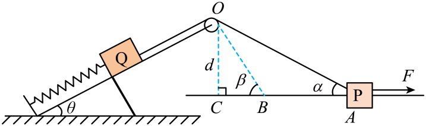

# Physics - 题目 2120

**ID**: 0c9a93d854344b9c9687fe3a84cea1c9
**年级**: Grade 12
**难度**: Medium-Hard
**题型**: Multiple-select

## 题目
如图所示，一固定在水平面上的光滑木板，与水平面的夹角 $θ=30{}^\circ $ ，木板的底端固定一垂直木板的挡板，上端固定一定滑轮O。​​​​​​​‌劲度系数为 $k=\frac {16mg}{5d}$ 的轻弹簧下端固定在挡板上，上端与质量为2m的物块Q连接。跨过定滑轮O的不可伸长的轻绳一端与物块Q连接，另一端与套在水平固定的光滑直杆上质量为m的物块P连接。初始时物块P在水平外力F作用下静止在直杆的A点，且恰好与直杆没有相互作用，轻绳与水平直杆的夹角 $α=37{}^\circ $ 。去掉水平外力F，物块P由静止运动到B点时轻绳与直杆间的夹角 $β=53{}^\circ $ 。已知滑轮到水平直杆的垂直距离为d，重力加速度大小为g，弹簧轴线、物块Q与定滑轮之间的轻绳共线且与木板平行，不计滑轮大小及摩擦。 ${\sin}37{}^\circ =0.6$ ， ${\cos}37{}^\circ =0.8$ ， ${\sin}53{}^\circ =0.8$ ， ${\cos}53{}^\circ =0.6$ 。则下列说法正确的是（      ）

## 解答

1. A．由于轻绳只能提供拉力，其对于物块P来说在从A点到B点过程中轻绳拉力的方向与其运动方向成锐角，即轻绳拉力对其做正功。而由于水平光滑直杆，所以物块P在该过程只有轻绳拉力做功，即物块P在该过程中机械能一直增加，A项错误；
2. C．对物块P在A点时进行受力分析，其恰好与直杆没有相互作用，所以绳子拉力在竖直方向的分力与重力大小相等，方向相反，即 $T{\sin}α=mg$ ，所以绳子的拉力为 $T=\frac {5}{3}mg$ ，对物块Q进行受力分析，在沿斜面方向上有 $T=2mg{\sin}θ+F{{}_{弹}}$ ，解得 $F{{}_{弹}}=\frac {2}{3}mg$ ，设弹簧拉伸的长度为x，由胡克定律有 $F{{}_{弹}}=kx$ ，解得 $x=\frac {5d}{24}$ ，C项正确；
3. B．物块P到B点时，由几何可得物块Q沿斜面向下滑了 $OA-OB=\frac {d}{{\sin}α}-\frac {d}{{\sin}β}=\frac {5d}{12}$ ，所以此时弹簧的压缩量为 $x^{′}=\frac {5d}{12}-\frac {5d}{24}=\frac {5d}{24}$ ，即此时弹簧的压缩量与初始时弹簧的拉伸量相同，也就是说此时弹簧的弹性势能与初始时弹簧的弹性势能相同。物块P从A点运动到B点的过程中，弹簧的弹力做功为零，所以由能量守恒可知，物块Q重力势能减少量之和等于物块P和Q两物块的动能的增加量，B项错误；
4. D．物块P运动到B点时，P和Q速度满足 $v{{}_{{\rm{Q}}}}=v{{}_{{\rm{P}}}}{\cos}β=\frac {3}{5}v{{}_{{\rm{P}}}}$ ，物块P从A点运动到B的过程中，由能量守恒有 $2mg\cdot \frac {5d}{12}{\sin}θ=\frac {1}{2}mv{{}_{{\rm{P}}}^{2}}+\frac {1}{2}·2mv{{}_{{\rm{Q}}}^{2}}$ ，对物块P由动能定理有 $W=\frac {1}{2}mv{{}_{{\rm{P}}}^{2}}$ ，解得 $W=\frac {125}{516}mgd$ ，D项正确。选CD。

## 知识点

**中文**:
  - 弹簧问题中机械能守恒定律的应用
  - 正交分解法与三角形定则在平衡问题中的应用

**English**:
  - Spring Problems
  - Orthogonal Decomposition and Triangle Rule in Equilibrium

---
