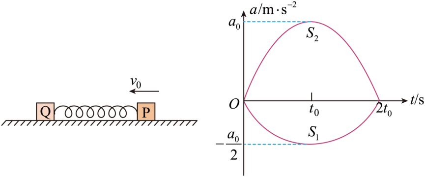

# Physics - 题目 1766

**ID**: 147852f538384a66b96f47d151ac5ed3
**年级**: Grade 12
**难度**: Medium-Hard
**题型**: Multiple-select

## 题目
如图所示，质量为m的物块P与物块Q（质量未知）之间拴接一轻弹簧，静止在光滑的水平地面上，弹簧恰好处于原长。​​​​​​​‌现给P物体一瞬时初速度 $v{{}_{0}}$ ，并把此时记为0时刻，规定向左为正方向， $0\sim 2t{{}_{0}}$ 内P、Q物块运动的 $a-t$ 图像如图所示，其中t轴下方部分的面积大小为 $S{{}_{1}}$ ，t轴上方部分的面积大小为 $S{{}_{2}}$ ，则（      ）

## 解答

1. AD． $0\sim 2t{{}_{0}}$ 时间内Q所受弹力方向向左，P所受弹力方向始终向右，弹簧始终对Q物体做正功； $t{{}_{0}}$ 时刻，PQ所受弹力最大且大小相等，由牛顿第二定律可得
2. $\frac {F{{}_{弹}}}{m{{}_{{\rm{P}}}}}=\frac {F{{}_{弹}}}{m}=\frac {a{{}_{0}}}{2}$
3. $\frac {F{{}_{弹}}}{m{{}_{{\rm{Q}}}}}=a{{}_{0}}$
4. 则物体Q的质量为 $\frac {1}{2}m$ ，故AD符合题意；
5. B．由a-t图像可知， $t{{}_{0}}$ 时刻Q物体的速度为
6. $v{{}_{{\rm{Q}}}}=\frac {1}{2}S{{}_{2}}$
7. 故B不符合题意；
8. C．由a-t图像可知， $t{{}_{0}}$ 时刻P物体的速度为
9. $v{{}_{{\rm{p}}}}=v{{}_{0}}-\frac {1}{2}S{{}_{1}}$
10. 故C符合题意。
11. 故选ACD。

## 知识点

**中文**:
  - 牛顿运动定律与图像结合问题

**English**:
  - Newton's Laws and Graphs

---
