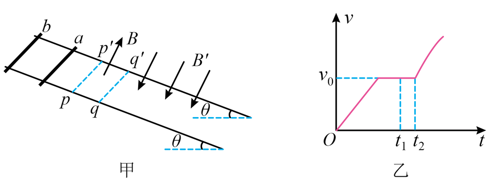

# Physics - 题目 116

**ID**: 155e922c363c4e18b8097b6ce2ab8ff8
**年级**: Grade 12
**难度**: Medium-Hard
**题型**: Multiple-select

## 题目
如图甲所示，两根足够长的光滑平行金属直导轨固定，导轨间距为L，所在平面与水平面的夹角为 $θ=30{}\degree $ ，导轨间存在垂直于导轨平面、方向相反的匀强磁场，其磁感应强度的大小分别为B、 $B^{′}$ 。​​​​​​​‌ $pp^{′}$ 、 $qq^{′}$ 是垂直于导轨，间距为d的磁场边界。将质量分别为m、2m的金属棒a、b垂直导轨放置，a棒与 $pp^{′}$ 的间距也为d，两棒接入导轨之间的电阻均为R，其他电阻不计。现同时将两棒由静止释放，两棒与导轨始终垂直且接触良好。 $t{{}_{1}}$ 时刻a棒经过 $qq^{′}{\rm ，\mathit{b}}$ 棒恰好经过 $pp^{′}$ 进入磁场， $t{{}_{2}}$ 时刻b棒经过 $qq^{′}$ 。a棒运动的v-t图像如图乙所示，中间图线平行于横轴，重力加速度为g。下列说法正确的是（      ）

## 解答

1. 对a棒从开始到刚进入磁场过程根据机械能守恒 $mgd\sin 30{}\degree =\frac {1}{2}mv{{}_{0}}{^{2}}$ ，解得 $v{{}_{0}}=\sqrt {gd}$  $0～t{{}_{1}}$ 时间内，根据能量守恒 $mg\cdot 2d\cdot \sin 30{}\degree =\frac {1}{2}mv{{}_{0}}{^{2}}+Q$ ，由于两棒接入导轨之间的电阻相等，a棒上产生的焦耳热 $Q{{}_{a}}=\frac {1}{2}Q$ ，联立解得 $Q{{}_{a}}=\frac {1}{4}mgd{\rm ，B}$ 正确，C错误；设初始时两棒间的距离为 $Δx$ ，根据题意 $t{{}_{1}}$ 时刻a棒经过 $qq^{′}{\rm ，\mathit{b}}$ 棒恰好经过 $pp^{′}$ 进入磁场，该段过程a棒开始做匀加速运动，进入磁场后做匀速运动，b棒一直做加速度大小为 $g\sin 30{}\degree $ 的匀加速运动，对a棒 $\frac {d}{\frac {v{{}_{0}}}{2}}+\frac {d}{v{{}_{0}}}=t{{}_{1}}$ ，对b棒 $\frac {1}{2}g\sin 30{}\degree \cdot t{{}_{1}}{^{2}}=\Delta x+d$ ，联立解得 $\Delta x=\frac {5}{4}d$ ，设b棒刚好经过 $pp^{′}$ 进入磁场时的速度为 $v{{}_{b}}$ ，得 $v{{}_{b}}{^{2}}=2g\sin 30{}\degree \cdot \left ({{\rm{Δ}}x+d}\right )$ ，解得 $v{{}_{b}}=\frac {3}{2}v{{}_{0}}$ ，根据图像可知a棒在 $\mathrm{t}{{}_{1}}-\mathrm{t}{{}_{2}}$ 时间内做匀速运动，受力分析可知a棒在两区域磁场中时受到的安培力相等，由于a棒经过 $qq^{′}$ 后的一段时间后仍做匀速运动，可知此时电路中的电流不变，该段时间内两棒均做匀速运动，根据题意可知两棒切割磁感线产生的感应电动势相互叠加，为 $E^{′}=BL\cdot \frac {3}{2}v{{}_{0}}+B^{′}Lv{{}_{0}}$ ，此时a棒受到的安培力为 $F{{}_{2}}=B^{′}I^{′}L=B^{′}{\cdot }\frac {E^{′}}{2R}L$ ， $0-t{{}_{1}}$ 时间内对a棒受到的安培力为 $F{{}_{1}}=BIL=B\cdot \frac {BLv{{}_{0}}}{2R}\cdot L$ ，根据 $F{{}_{1}}=F{{}_{2}}$ ，联立解得 $\frac {B^{′}}{B}=\frac {1}{2}{\rm ，A}$ 正确；b棒在磁感应强度为B的磁场中运动的时间为 $t{{}_{b}}=\frac {d}{\frac {3}{2}v{{}_{0}}}=\frac {2d}{3v{{}_{0}}}$ ，该段时间a棒运动的位移为 $x{{}_{a}}=v{{}_{0}}t{{}_{b}}=\frac {2d}{3}$ ， $t{{}_{2}}$ 时刻两棒间距离为 $\frac {2d}{3}$ ，该时刻后两棒均做加速运动，假设可以到达共速 $v{{}_{共}}$ ，沿斜面向下为正方向，对两棒分别由动量定理得 $mg\sin 30{}\degree \cdot t+B^{′}{{\overline{I}}}Lt=mv{{}_{共}}-mv{{}_{0}}$ ， $2mg\sin 30{}\degree \cdot t-B^{′}{{\overline{I}}}Lt=2mv{{}_{共}}-2m\cdot \frac {3}{2}v{{}_{0}}$ ，同时有 ${\overline{I}}t=\frac {{\overline{E}}}{2R}t=\frac {\Delta {\rm{Φ}}}{2R}=\frac {B^{′}L\Delta x^{′}}{2R}$ ， ${\rm{Δ}}x^{′}$ 为两棒相对位移，根据前面分析对a棒在磁感应强度为B的磁场中运动时有 $B\cdot \frac {BLv{{}_{0}}}{2R}\cdot L=mg\sin 30{}\degree $ ，联立解得 $\Delta x^{′}=\frac {8}{3}d{\rm{>}}\frac {2}{3}d$ ， $t{{}_{2}}$ 时刻后，a、b两棒最终会相遇，D正确。

## 知识点

**中文**:
  - 电磁感应现象中的功能问题

**English**:
  - Work-Energy Problems in EM Induction

---
