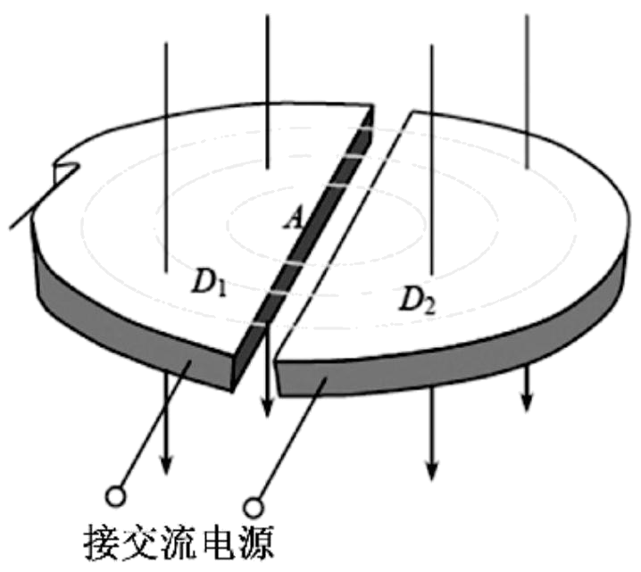

# Physics - 题目 515

**ID**: 17552dcb60e24f8cbf0205a1d035aece
**年级**: Grade 12
**难度**: Medium-Hard
**题型**: Multiple-select

## 题目
回旋加速器核心部分是分别与高频交流电源两极相连接的两个D型金属盒，两盒间的狭缝中形成周期性变化的电场，使粒子在通过狭缝时都能得到加速，两D型金属盒处于垂直于盒底的匀强磁场中，如图所示。​​​​​​​‌位于D_{1}圆心处的质子源A能不断产生质子（初速度可以忽略，重力不计），它们在两盒之间被电场加速，所加匀强磁场的磁感应强度为B。D型盒半径为R，两盒间所加高频交流电源电压的最大值为U，缝隙的宽度为d，质子的电量为q，质量为m。不考虑相对论效应，忽略缝隙间磁场对质子运动的影响。设质子每次都能在最高电压下加速。下列说法正确的是（      ）

## 解答

1. 若粒子每次在缝隙间都能被加速，则交流电的频率与磁场中回旋的频率必须相等，所以 $f=\frac {1}{T}=\frac {1}{\frac {2πm}{Bq}}=\frac {Bq}{2πm}$ ，即磁场中回旋的频率与粒子的比荷有关，质子和α粒子的比荷不同，所以不做任何调试，不能用此回旋加速器直接用来加速α粒子，故A错误；质子在加速器中获得的最大速度为v_{m}，则 $Bqv{{}_{{\rm{m}}}}=m\frac {v{{}_{{\rm{m}}}^{2}}}{R}$ ，设在磁场中绕的圈数为n，则 $n\cdot 2Uq=\frac {1}{2}mv{{}_{{\rm{m}}}^{2}}-0$ ，磁场中回旋的周期为 $T=\frac {2πm}{Bq}$ ，磁场中运行的总时间为 $t{{}_{1}}=nT$ ，解得 $t{{}_{1}}=\frac {πBR{^{2}}}{2U}$ ，在电场中加速过程 $v{{}_{{\rm{m}}}}=at{{}_{2}}$ ， $a=\frac {Uq}{dm}$ ，解得 $t{{}_{2}}=\frac {BdR}{U}$ ，故B正确；电场对每个质子做功的平均功率为 $P=\frac {W}{t{{}_{1}}+t{{}_{2}}}=\frac {\frac {1}{2}mv{{}_{{\rm{m}}}^{{{2}}}}}{\frac {πBR{^{2}}}{2U}+\frac {BdR}{U}}=\frac {Bq{^{2}}RU}{m(πR+2d)}$ ，故C错误；设k为同一D型盒子中运动轨道半径的序数，相邻的轨道半径分别为 $r{{}_{k}}$ ， $r{{}_{k+1}}$ （ $r{{}_{k+1}}>r{{}_{k}}$ ），所以 ${\rm{Δ}}r{{}_{k}}=r{{}_{k+1}}-r{{}_{k}}$ ，在相应轨道上质子对应的速度大小分别为 $v{{}_{k}}$ ， $v{{}_{k+1}}$ ，所以 $2Uq=\frac {1}{2}mv{{}_{k+1}^{2}}-\frac {1}{2}mv{{}_{k}^{2}}$ ，根据洛伦兹力提供向心力 $Bqv{{}_{k}}=m\frac {v{{}_{k}^{2}}}{r{{}_{k}}}$ ， $Bqv{{}_{k+1}}=m\frac {v{{}_{k+1}^{2}}}{r{{}_{k+1}}}$ ，解得 ${\rm{Δ}}r{{}_{k}}=\frac {4U}{B(v{{}_{k+1}}+v{{}_{k}})}$ ，同理 ${\rm{Δ}}r{{}_{k+1}}=\frac {4U}{B(v{{}_{k+2}}+v{{}_{k+1}})}$ ，可见 ${\rm{Δ}}r{{}_{k+1}}<{\rm{Δ}}r{{}_{k}}$ ，即轨迹越来越密，故D正确。

## 知识点

**中文**:
  - 回旋加速器

**English**:
  - Cyclotron

---
