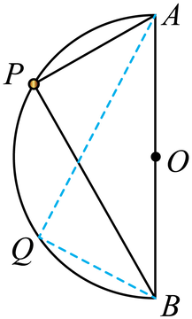

# Physics - 题目 1793

**ID**: 18f874fb05c347e2ae7f6a9a884c219b
**年级**: Grade 12
**难度**: Medium-Hard
**题型**: Multiple-select

## 题目
一光滑的半圆形支架固定于竖直平面内，半圆的半径为R，圆心为O，AB为直径，AB在竖直方向上，圆弧上穿一小球，小球可沿圆弧滑动，两根完全相同的橡皮筋一端固定在小球上，另一端分别固定在A、B两点，橡皮筋的原长为R，橡皮筋的弹力遵循胡克定律，劲度系数为k，橡皮筋具有的弹性势能为 $\frac {1}{2}kx{^{2}}$ （k为橡皮筋的劲度系数，x为橡皮筋的形变量），初始时小球锁定在P点，已知 $\angle PAB=60{}\degree $ ，某一时刻解除锁定，小球沿圆弧运动到Q点， $\angle QAB=30{}\degree $ 。​​​​​​​‌下列说法正确的是（      ）

## 解答

1. 根据几何关系可知小球在 $P$ 、 $Q$ 两点时，两根橡皮筋的长度恰好互换，即在 $P$ 、 $Q$ 两点两根橡皮筋的弹性势能之和相等，但在过程中，小球的机械能不守恒，对小球在 $P$ 、 $Q$ 两点，根据机械能守恒定律 $mg\cdot (2R\sin 60{}\degree \cdot \sin 60{}\degree -2R\sin 30{}\degree \cdot \sin 30{}\degree )=\frac {1}{2}mv{{}_{Q}^{2}}$ ，解得 $v{{}_{Q}}=\sqrt {2g\cdot R}{\rm ，A}$ 错误，C正确；设小球所在位置与A连线和竖直方向夹角为 $θ$ ，根据几何关系，两橡皮筋长度分别为 $L{{}_{1}}=2R\sin θ$ 、 $L{{}_{2}}=2R{\cos}θ$ ，形变量分别为 $Δx{{}_{1}}=2R\sin θ-R$ 、 $Δx{{}_{2}}=2R{\cos}θ-R$ ，橡皮筋弹性势能之和 $E{{}_{{\rm{p}}}}=\frac {1}{2}k(Δx{{}_{1}}){^{2}}+\frac {1}{2}k(Δx{{}_{2}}){^{2}}$ ，联立可得 $E{{}_{{\rm{p}}}}=kR{^{2}}\left [3-（2\sin θ+2{\cos}θ）\right ]=kR{^{2}}\left [3-2\sqrt {2}\sin （θ+45{}\degree ）\right ]$ ，可知当 $θ=45{}\degree $ 时，两橡皮筋弹性势能之和最小为 $E{{}_{{\rm{p}}}}=\left ({3-2\sqrt {2}}\right )kR{^{2}}{\rm ，B}$ 正确；若小球运动到Q点时速度恰好达最大值，根据几何关系可知下面的橡皮筋恢复原长，沿着运动轨迹切线方向的合力为零，对小球进行受力分析，沿切线方向有 $mg\sin 30\degree =k\left ({2R\sin 60\degree -R}\right ){\cos}60\degree $ ，解得 $m=\frac {\left ({3-\sqrt {3}}\right )kR}{3g}{\rm ，D}$ 错误。

## 知识点

**中文**:
  - 绳球模型圆周运动中机械能守恒定律的应用

**English**:
  - String-Ball Circular Motion Models

---
