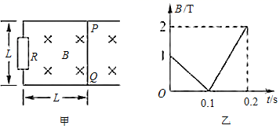

# Physics - 题目 1349

**ID**: 1abc7c89f5624dd08c28837550844255
**年级**: Grade 12
**难度**: Medium-Hard
**题型**: Multiple-select

## 题目
间距为L=1m的导轨固定在水平面上，如图甲所示，导轨的左端接有阻值为R=10Ω的定值电阻，长度为L=1m、阻值为r=10Ω的金属棒PQ放在水平导轨上，与导轨有良好的接触，现在空间施加一垂直导轨平面的磁场，磁感应强度随时间的变化规律如图乙所示，已知磁场的方向如图甲所示，且0~0.2s的时间内金属棒始终处于静止状态，其他电阻不计。​​​​​​​‌则下列说法正确的是（      ）

## 解答

1. AB．由图乙可知，0~0.1s的时间内磁感应强度逐渐减小，则穿过回路的磁通量逐渐减小，由楞次定律可知流过金属棒的电流方向由P到Q，则金属棒所受的安培力方向水平向右，摩擦力的方向水平向左；0.1s~0.2s的时间内磁感应强度逐渐增大，穿过回路的磁通量逐渐增加，由楞次定律可知流过金属棒的电流方向由Q到P，则金属棒所受的安培力方向水平向左，摩擦力的方向水平向右，A项错误，B项正确；
2. C．由图乙所示图像，应用法拉第电磁感应定律可得，0~0.1s的时间内感应电动势
3. $E{{}_{1}}=\frac {ΔΦ}{Δt}=\frac {L{^{2}}\cdot ΔB}{Δt}=10{\rm{V}}$
4. 感应电流为
5. $I{{}_{1}}=\frac {E{{}_{1}}}{R+r}=0.5{\rm{A}}$
6. C项错误；
7. D．由图乙所示图像，应用法拉第电磁感应定律可得，0~0.1s的时间内通过电阻R的电荷量
8. $q=\frac {ΔΦ}{R+r}=\frac {1\times 1{^{2}}}{10+10}{\rm{C}}{\rm{=}}{\rm{0}}{\rm{.}}{\rm{0}}{\rm{5}}{\rm{C}}$
9. D项正确。
10. 故选BD。

## 知识点

**中文**:
  - 单杆模型
  - 楞次定律及其应用

**English**:
  - Single Rod Model
  - Lenz's Law and Applications

---
