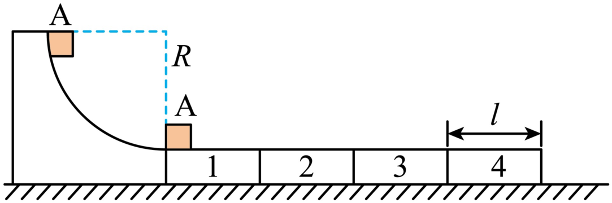

# Physics - 题目 1998

**ID**: 25e4e5da02554475a18e0a67d96bcb1f
**年级**: Grade 12
**难度**: Medium-Hard
**题型**: Multiple-select

## 题目
如图所示，半径R=0.8m的四分之一光滑圆弧轨道竖直固定于水平面上。​​​​​​​‌4个相同的木板紧挨着圆弧轨道末端静置，圆弧轨道末端与木板等高，每块木板的质量为m=1kg，长l=1.5m。它们与地面间的动摩擦因数μ_{1}=0.1，木板与地面的最大静摩擦力等于滑动摩擦力。现让一质量M=2.5kg物块A（可视为质点）从圆弧顶端由静止滑下，物块与木板间的动摩擦因数μ_{2}=0.2，g=10m/s^{2}，则下列说法正确的是（      ）

## 解答

1. 物块A从释放滑到曲面轨道下端，根据动能定理有 $MgR=\frac {1}{2}Mv{^{2}}$ ，物块A刚滑上木板1时，对物块A，其所受到摩擦力为 $f{{}_{1}}=μ{{}_{2}}Mg=5{\rm{N}}$ ，将4块木板看成整体，其与地面之间的最大静摩擦力为 $f{{}_{2}}=μ{{}_{1}}\left ({M+4m}\right )g=6.5{\rm{N}}$ ，由于f_{2}>f_{1}，故物块A滑离木板1时，4块木板整体静止，对物块A在木板1上滑动时，根据动能定理有 $-μ{{}_{2}}Mgl=\frac {1}{2}Mv{{}_{1}^{2}}-\frac {1}{2}Mv{^{2}}$ ，解得 $v{{}_{1}}=\sqrt {10}{\rm{m}}{\rm{/}}{\rm{s}}$ ，故A错误；设物块A刚滑至第n块木板时，该木板开始滑动，该木板及后面木板受到地面的最大静摩擦力为 $f{{}_{2}}=μ{{}_{1}}\left [M+\left ({4-n+1}\right )m\right ]g$ ，要使木板滑动，则有f_{1}>f_{2}，解得n>2.5即物块A滑上第3块木板时，木板开始滑动，故B错误；物块A在前两个木板上滑动过程中有，根据动能定理有 $-μ{{}_{2}}Mg2l=\frac {1}{2}Mv{{}_{3}^{2}}-\frac {1}{2}Mv{^{2}}$ ，解得物块A刚滑至木板3时的速度为 $v{{}_{3}}=2{\rm{m}}{\rm{/}}{\rm{s}}$ 。，物块滑上第3块木板后继续做匀减速直线运动，第3块木板和第4块木板一起向右做匀加速直线运动，由牛顿第二定律有 $μ{{}_{2}}Mg-μ{{}_{1}}\left ({2m+M}\right )g=2ma^{′}$ ，对物块由牛顿第二定律有 $μ{{}_{2}}Mg=Ma^{′}$ ，由运动学知识当物块与木板共速时有 $v{{}_{3}}-at=a^{′}t$ ，联立解得 $t=\frac {8}{9}{\rm{s}}$ ，由运动学知识有此时相对位移为 $\Delta x=v{{}_{3}}t-\frac {1}{2}at{^{2}}-\frac {1}{2}a^{′}t{^{2}}=\frac {8}{9}{\rm{m}}<l$ ，未滑出第3块木板，故C正确；物块A能滑上第三块木板后，才能使3、4两块木板滑动，由功能关系可知在木板滑动前，系统因摩擦所生的热为 $Q=μ{{}_{2}}Mg\times 2l=15{\rm{J}}$ ，故D正确。

## 知识点

**中文**:
  - 板块模型中的能量守恒问题

**English**:
  - Energy Conservation in Plate Models

---
