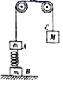

# Physics - 题目 1710

**ID**: 269cd0b8c2894f8a99c696a6883684c7
**年级**: Grade 12
**难度**: Medium-Hard
**题型**: Multiple-select

## 题目
如图所示质量均为m的物体AB通过轻质弹簧连接；物体A、C通过轻绳连接在光滑的轻质定滑轮两侧，用手托着质量为M的物体C使A静止在弹簧上，物体B静止在地面上，绳伸直恰无弹力。​​​​​​​‌忽略空气阻力，放手后物体C下落，直至物体B对地面恰好无压力。若将C换成大小为Mg的竖直向下的拉力作用，也直至物体B对地面恰好无压力。两种情况下，此时A的动能分别表示为 $E{{}_{k1}}$ 、 $E{{}_{k2}}$ ，A的重力势能分别表示为 $E{{}_{p{{}_{1}}}}$ 、 $E{{}_{p{{}_{2}}}}$ ，弹簧的弹性势能分别表示为 $E{{}_{p{{}_{k{{}_{1}}}}}}$ 、 $E{{}_{p{{}_{k{{}_{2}}}}}}$ ，细绳对A所做的功分别表示为 $W{{}_{1}}$ 、 $W{{}_{2}}$ ，重力加速度为g，则下列说法中正确的是（      ）

## 解答

1. A．开始时弹簧被压缩
2. $Δx=\frac {mg}{k}$
3. 当物块B恰对地面无压力时，弹簧的弹力等于mg，此时弹簧伸长
4. $Δx{^{^{′}}}=\frac {mg}{k}$
5. 则两种情况下弹簧的形变量相同，弹簧的弹性势能不变；由能量关系，第一种情况：
6. $Mgh=mgh+\frac {1}{2}(m+M)v{^{2}}$
7. 第二种情况：
8. $Mgh=mgh+\frac {1}{2}mv{^{^{′}2}}$
9. 若M=m，则v=v′，即 $E{{}_{k1}}=E{{}_{k2}}$ ，选项A正确；
10. B．两种情况下弹簧长度均变化 $h=\frac {2mg}{k}$ ，即A上升的高度相同，重力势能变化量相同，选项B错误；
11. C．两种情况下弹簧伸长量相同，则弹性势能相同，选项C错误；
12. D．由A的分析可知，若M>m，则v<v′，第一种情况下绳子对A做功：
13. $W{{}_{1}}=mgh+\frac {1}{2}mv{^{2}}$
14. 第二种情况下绳子对A做功：
15. $W{{}_{2}}=mgh+\frac {1}{2}mv{^{^{′}2}}$
16. 则
17. $W{{}_{1}}<W{{}_{2}}$
18. 选项D正确；
19. 故选AD。

## 知识点

**中文**:
  - 应用动能定理求解连接体问题
  - 弹簧问题中机械能守恒定律的应用

**English**:
  - Solving Connected Body Problems
  - Spring Problems

---
