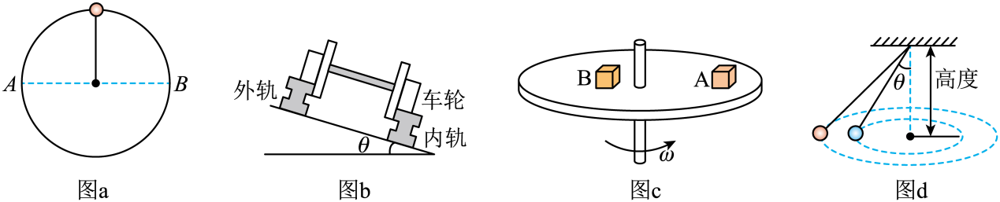

# Physics - 题目 440

**ID**: 27a451f9abe14d688ceadfb8532efb8e
**年级**: Grade 12
**难度**: Medium-Hard
**题型**: Multiple-select

## 题目
如图所示的四幅图表示的是有关圆周运动的基本模型，下列说法正确的是（      ）​​​​​​​‌

## 解答

1. 当小球在最高点时，若杆对小球没有作用力，根据重力提供向心力，则 $mg=m\frac {v{^{2}}}{l}$ ，可得：  $v=\sqrt {gl}$ ，当小球在最高点的速率 $v<\sqrt {gl}$ 时，重力大于所需的向心力，此时杆对小球有向上的支持力，以平衡重力并提供向心力。故A正确；设火车转弯时的速率 $v$ ，轨道半径 $R$ ，内外轨高度差 $H$ ，车轮与轨道间的距离 $L$ ，当火车以设计速率 $v{{}_{0}}$ 转弯时，重力与支持力的合力提供向心力，即 $mg{\tan}θ=m\frac {v{{}_{0}^{2}}}{R}$ ，其中:  ${\tan}θ=\frac {H}{L}$ ，当火车转弯速率 $v<v{{}_{0}}$ 时，重力与支持力的合力大于所需的向心力，火车有向内侧运动的趋势，轮缘对内轨道有横向挤压作用，而不是外轨道。故B错误。物体随圆盘一起做圆周运动时，动摩擦因数 $μ$ 相同，静摩擦力提供向心力，即 $F{{}_{f}}=mω{^{2}}R$ ，当刚好要滑动时，  ${\rm }{\rm μm}g=mω{^{2}}R$ ，可得：  $ω=\sqrt {\frac {μg}{R}}{\rm }$ ，已知 $R{{}_{{\rm{A}}}}=2R{{}_{{\rm{B}}}}$ ,则:  $ω{{}_{{\rm{A}}}}=\sqrt {\frac {μg}{R{{}_{{\rm{A}}}}}}$ , $ω{{}_{{\rm{B}}}}=\sqrt {\frac {μg}{R{{}_{{\rm{B}}}}}}$ ，所以 $ω{{}_{{\rm{A}}}}<ω{{}_{{\rm{B}}}}$ ，则当从零开始逐渐增大圆盘转速时，A先相对圆盘滑动。故C错误；两个小球在相同高度的水平面内做匀速圆周运动，小球受到重力 $mg$ 和绳子拉力 $T$ ，它们的合力提供向心力。根据几何关系： $F{{}_{合}}=mg{\tan}θ=mω{^{2}}r$ ，又：  $r=h{\tan}θ$ ，则：  $mg{\tan}θ=mω{^{2}}h{\tan}θ$ ，可得：  $ω=\sqrt {\frac {g}{h}}$ ，因为两个小球在相同高度的水平面内做匀速圆周运动，即 $h$ 相同，所以它们的角速度大小相同。

## 知识点

**中文**:
  - 圆锥摆问题
  - 火车转弯问题
  - 绳、杆类圆周运动问题
  - 水平面内匀速圆周问题

**English**:
  - Conical Pendulum Problems
  - Train Turning Problems
  - String and Rod Circular Motion Problems
  - Uniform Circular Motion in Horizontal Plane

---
