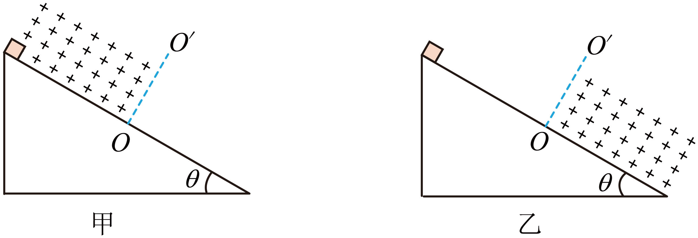

# Physics - 题目 2983

**ID**: 2a66f3074a4e48faaaefc3abcb34a077
**年级**: Grade 12
**难度**: Medium-Hard
**题型**: Multiple-select

## 题目
如图所示为两个完全相同的倾角为 $θ$ 的绝缘固定斜面，以斜面中垂线 $OO^{′}$ 为界，图甲中斜面的上半部分和图乙中斜面的下半部分空间分别存在磁感应强度大小均为 $B$ 、方向均垂直纸面向里的匀强磁场。​​​​​​​‌一质量为 $m$ 、电荷量为 $-q$ 的小滑块（可视为质点）分别从两斜面的顶端由静止释放后滑到斜面底端。小滑块在图甲中斜面运动时，小滑块经过斜面中点前瞬间的加速度为0，小滑块经过斜面中点时的速度为 $v{{}_{1中}}$ ，到达斜面底端时的速度为 $v{{}_{1}}$ ；小滑块在图乙中斜面运动时，小滑块经过斜面中点时的速度为 $v{{}_{2中}}$ ，到达斜面底端时的速度为 $v{{}_{2}}$ 。已知小滑块与斜面间的动摩擦因数均为 $μ(μ<{\rm{t}}{\rm{a}}{\rm{n}}θ)$ ，重力加速度为g，下列说法正确的是（      ）

## 解答

1. 在图甲中，小滑块在斜面的上半部分受到重力、摩擦力、支持力和洛伦兹力的作用。由于小滑块经过斜面中点前瞬间的加速度为0，说明此时小滑块受到的合外力为0。设斜面的长度为L，则小滑块在斜面中点时的速度为v_{1}_{中}，此时的洛伦兹力为qBv_{1}_{中}。根据平衡条件，有 $mg{\rm{s}}{\rm{i}}{\rm{n}}θ=μ\left ({mg{\rm{c}}{\rm{o}}{\rm{s}}θ+qBv{{}_{1中}}}\right )$ ，解得 $v{{}_{1中}}=\frac {mg{\rm{s}}{\rm{i}}{\rm{n}}θ-{\rm μm}g{\rm{c}}{\rm{o}}{\rm{s}}θ}{μqB}$ ，故A正确；图乙中前半段根据牛顿第二定律，有 $mg\sin θ-{\rm μm}g{\cos}θ=ma{{}_{乙}}$ ，图甲中前半段根据牛顿第二定律，有 $mg\sin θ-μ\left ({mg{\cos}θ+qvB}\right )=ma{{}_{甲}}$ ，由此可知 $a{{}_{乙}}>a{{}_{甲}}$ ，根据速度-位移公式，有 $v{^{2}}=2a\times \frac {L}{2}$ ，可知 $v{{}_{2中}}$ 一定大于 $v{{}_{1中}}$ ，故B正确；由上分析可知图甲中小滑块出磁场后做匀加速运动，到达底端的速度v_{1}一定大于v_{1}_{中}，图乙中小滑块进磁场的速度一定大于v_{1}_{中}，所以即小滑块进场将做减速运动，可能一直减速滑到最底端，也可能先减速后匀速滑出磁场，所以v_{2}不可能小于v_{1}_{中}；从顶端滑到底端重力做功相同，乙种情况在磁场中的平均摩擦力要大于甲种情况的平均摩擦力，即克服摩擦力做功乙种情况较大，所以v_{2}一定小于v_{1}，故C正确，D错误。

## 知识点

**中文**:
  - 带电粒子在匀强磁场中的运动

**English**:
  - Motion of Charged Particles in Uniform Magnetic Field

---
