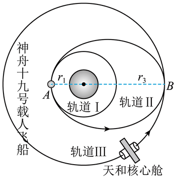

# Physics - 题目 75

**ID**: 2cf4094c2f6145cc83161f1f40881283
**年级**: Grade 12
**难度**: Medium-Hard
**题型**: Multiple-select

## 题目
如图是神舟十九号载人飞船与天和核心舱成功对接的示意图。​​​​​​​‌天和核心舱处于半径为 $r{{}_{3}}$ 的圆轨道Ⅲ上；神舟十九号飞船处于半径为 $r{{}_{1}}$ 的圆轨道I上，运行周期为 $T{{}_{1}}$ ，经过A点时，通过变轨操作后，沿椭圆轨道Ⅱ运动到B点与核心舱对接，则神舟十九号飞船（      ）

## 解答

1. 神舟十九号飞船沿轨道Ⅱ运动过程中，A点为近地点，B点为远地点，根据开普勒第二定律可知，近地点的速度大于远地点的速度，即 $v{{}_{A}}>v{{}_{B}}{\rm ，A}$ 错误；飞船沿轨道Ⅱ从A点运动到B点的过程中，万有引力做负功，神舟十九号飞船动能减小，势能增大，机械能守恒，B错误；神舟十九号飞船在圆轨道做匀速圆周运动，由万有引力提供向心力，则有 $G\frac {Mm}{r{^{2}}}=m\frac {v{^{2}}}{r}$ ，解得 $v=\sqrt {\frac {GM}{r}}$ ，轨道I和轨道III都是圆轨道，且 $r{{}_{1}}<r{{}_{3}}$ ，则有 $v{{}_{1}}>v{{}_{3}}$ ；飞船从轨道Ⅱ运动到B处时加速做离心运动进入轨道Ⅲ，因此在轨道Ⅰ上的速度大于沿轨道Ⅱ运动经过B点的速度，C正确；神舟十九号飞船沿轨道Ⅱ运动时，由开普勒第三定律可得 $\frac {r{{}_{1}^{3}}}{T{{}_{1}^{2}}}=\frac {{\left({\frac {r{{}_{1}}+r{{}_{3}}}{2}}\right)^{3}}}{T{{}_{2}^{2}}}$ ，解得 $T{{}_{2}}=T{{}_{1}}\sqrt {(\frac {r{{}_{1}}+r{{}_{3}}}{2r{{}_{1}}}){^{3}}}$ ，飞船从A点沿椭圆轨道Ⅱ运动到B点所用的时间 $t=\frac {T{{}_{2}}}{2}=\frac {T{{}_{1}}}{2}\sqrt {(\frac {r{{}_{1}}+r{{}_{3}}}{2r{{}_{1}}}){^{3}}}{\rm ，D}$ 正确。

## 知识点

**中文**:
  - 卫星变轨与对接问题
  - 开普勒三大定律及其应用

**English**:
  - Satellite Orbit Change and Docking
  - Kepler's Three Laws and Applications

---
