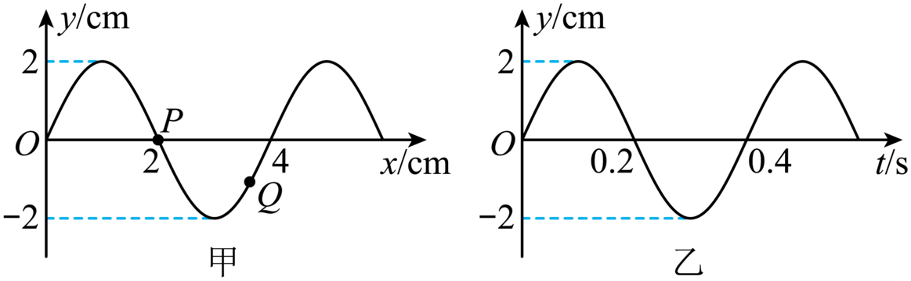

# Physics - 题目 1271

**ID**: 3127f5cf7856439692e365e908a16e12
**年级**: Grade 12
**难度**: Medium-Hard
**题型**: Multiple-select

## 题目
如图所示，甲为一列简谐波在某一时刻的波形图，乙为介质中x=2m处的质点P以此时刻为计时起点的振动图象，质点Q的平衡位置位于x=3.​​​​​​​‌5m处，下列说法正确的是（      ）

## 解答

1. 由图知，波长为 $λ=4{\rm{m}}$ ，周期为T=0.4s，则波速为 $v=\frac {λ}{T}=10{\rm{m}}/{\rm{s}}{\rm ，A}$ 错误；由乙图读出，t=0时刻质点P的速度向上，由波形的平移法可知，这列波沿x轴正方向传播，B正确；根据波的传播特点可知，质点并不随波向前迁移，而是在平衡位置附近做简谐运动，C错误；当t=0.1s时，质点P处于最大位移处，据简谐运动的特点可知，此时加速度最大；而质点Q此时不在最大位移处，所以质点P的加速度大于质点Q的加速度，D正确。

## 知识点

**中文**:
  - 波的图像及其应用
  - 简谐运动
  - 波的图像和振动图像的综合应用

**English**:
  - Wave Graphs and Applications
  - Simple Harmonic Motion
  - Integrated Application of Wave and Vibration Graphs

---
