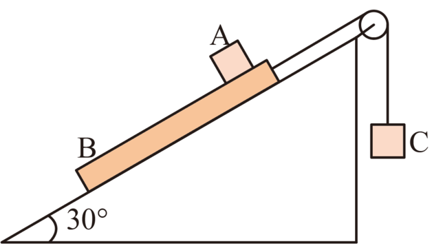

# Physics - 题目 1452

**ID**: 320917550ad5499b97a7ddb27ef7eb70
**年级**: Grade 12
**难度**: Medium-Hard
**题型**: Multiple-select

## 题目
如图，一倾角为30°的光滑斜面物体M静止在地面上，斜面顶端装有一光滑的轻质定滑轮。​​​​​​​‌一细绳跨过滑轮，一端悬挂物块C，另一端与斜面上的长木板B相连，长木板B上有一物块A。A、B的质量都为2m，C的质量为m，A、B之间的摩擦因数 $μ$ = $\frac {\sqrt {3}}{15}$ ，重力加速度为g。起初用手将四个物体按照图示位置保持静止，松手后，物体M保持不动。则下列关于松手后，A、B、滑轮和M的说法正确的是（      ）

## 解答

1. AB．对A物体，因为
2. $2{\rm μm}g{\cos}30{}^\circ <2mg{\sin}30{}^\circ $
3. 故A将会下滑，其加速度
4. $a{{}_{1}}=\frac {2mg{\sin}30{}^\circ -2{\rm μm}g{\cos}30{}^\circ }{2m}=\frac {2}{5}g$
5. 故A对B的摩擦力大小为
6. $f{{}_{1}}=2{\rm μm}g{\cos}30{}^\circ $
7. 对B和C整体，根据牛顿第二定律
8. $f{{}_{1}}+2mg{\sin}30{}^\circ -mg=(2m+m)a{{}_{2}}$
9. 解得
10. $a{{}_{2}}=\frac {g}{15}$
11. 故A错误，B正确；
12. C．对物体C，根据牛顿第二定律
13. $T-mg=ma{{}_{2}}$
14. 滑轮受到细绳的作用力
15. $F=2T{\cos}30{}^\circ $
16. 解得
17. $F=\frac {16}{15}\sqrt {3}mg$
18. 故C错误；
19. D．对A、B、C及斜面体整体，水平方向，根据牛顿第二定律
20. $f=2ma{{}_{1}}{\cos}30{}^\circ +2ma{{}_{2}}{\cos}30{}^\circ $
21. 解得，地面对斜面体的摩擦力
22. $f=\frac {7\sqrt {3}}{15}mg$
23. 故D正确。
24. 故选BD。

## 知识点

**中文**:
  - 斜面模型与等时圆模型
  - 连接体问题（整体和隔离法）、临界问题
  - 板块模型

**English**:
  - Inclined Plane Model and Isochronous Circle Model
  - Connected Bodies Problems (Whole/Isolation Method), Critical Problems
  - Plate Model

---
