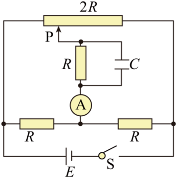

# Physics - 题目 2550

**ID**: 32b36f45855d49a3b504b34a898521f5
**年级**: Grade 12
**难度**: Medium-Hard
**题型**: Multiple-select

## 题目
某电路图如图所示，电源电动势 $E=6{\rm{V}}$ ，内阻不计，电阻均为定值电阻，且 $R=10Ω$ ，电容器的电容C=100μF，电流表是理想电流表。​​​​​​​‌则在滑片P从最右端缓慢滑到最左端的过程中，下列说法正确的是（      ）

## 解答

1. AB．当滑片P在最右端时的等效电路图，如图所示。
2. 
3. 当滑片P在最左端时的等效电路图，如图所示。
4. 
5. 当滑片P在中间位置时的等效电路图，如图所示，由图可知，滑片P和B点的电势相等，则P、B间的电压是零，则电流表的示数是零，由此可知，当滑片P从最右端缓慢滑到最左端时，电流表的示数先变小后变大，A正确，B错误：
6. 
7. CD．当滑片P在最右端时，电容器上极板接电源的负极，上极板带负电，下极板带正电，当滑片P在最左滑时，电容器上极板接电源的正极，上极板带正电，下极板带负电，可知电容器先放电后反向充电，由前两个解析图可知，电容器两端电压等于与它并联的电阻R两端电压，可得 $U=\frac {E}{R+\frac {R}{2}}\times \frac {R}{2}=\frac {6\times 10}{15\times 2}{\rm{V}}=2{\rm{V}}$ ，则有当滑片P在最右端时，电容器电压是−2V，当滑片P在最左端时，电容器电压是2V，由电容的定义式 $C=\frac {Q}{U}$ 可得，电容器上电荷量 $Q=CU=100\times 10{^{-6}}\times 2{\rm{C}}=2\times 10{^{-4}}{\rm{C}}$ ，则有电容器上电荷量的变化量为 $ΔQ=Q-\left ({-Q}\right )=2Q=2\times 2\times 10{^{-4}}{\rm{C}}=4\times 10{^{-4}}{\rm{C}}$ ，C错误，D正确。选AD。

## 知识点

**中文**:
  - 电容器的充放电过程及其动态分析

**English**:
  - Capacitor Charge/Discharge and Dynamic Analysis

---
