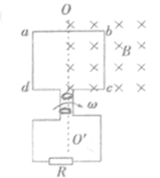

# Physics - 题目 34

**ID**: 341ef10c0ef14ef8b41e28cfd29da8a5
**年级**: Grade 12
**难度**: Medium-Hard
**题型**: Multiple-select

## 题目
如图所示，边长为L=0.2m的正方形线圈abcd，其匝数为n=10，总电阻为r=2Ω，外电路的电阻为R=8Ω，ab中点和cd中点的连线OO′恰好位于匀强磁场的边界线上，磁场的磁感应强度为B=1T。​​​​​​​‌若线圈以角速度ω=2rad/s绕轴OO′匀速转动，并从图示位置开始计时，则下列说法正确的是（      ）

## 解答

1. A．周期为
2. $T=\frac {2{\rm{π}}}{ω}={\rm{π}}{\rm{s}}$
3. 在t= $\frac {{\rm{π}}}{2}$ s时刻，线圈从图示位置转过 $180^\circ $ ，此时磁场穿过线圈的磁通量最大，但此时磁通量随时间变化最小，感应电动势最小，故A错误；
4. B．闭合电路中感应电动势的瞬时表达式 $e=E{{}_{m}}{\rm{s}}{\rm{i}}{\rm{n}}ωt$ ，且
5. $E{{}_{m}}=nBLv=nBLω\cdot \frac {L}{2}=\frac {1}{2}nBL{^{2}}ω=\frac {1}{2}\times 10\times 1\times 0.04\times 2{\rm{V}}=0.4{\rm{V}}$
6. 则表达式
7. $e=0.4{\rm{s}}{\rm{i}}{\rm{n}}2t（{\rm{V}}）$
8. 故B错误；
9. C．在转过 $90^\circ $ 的过程中感应电动势的平均值为 ${\overline{E}}=n\frac {ΔΦ}{Δt}$ ，流过R的平均电流为 ${\overline{I}}=\frac {{\overline{E}}}{R+r}$ ，解得流过R的电量为
10. $q=\frac {nBL{^{2}}}{2(R+r)}=\frac {10\times 1\times 0.04}{2\times 10}{\rm{C}}=2\times 10{^{-2}}{\rm{C}}$
11. 故C正确；
12. D．在线框由图示位置匀速转动 $90^\circ $ 的过程中，用有效值来计算电阻R产生的热量，则
13. $E=\frac {E{{}_{m}}}{\sqrt {2}}$
14. $I=\frac {E}{R+r}=\frac {0.4}{\sqrt {2}\times (8+2)}{\rm{A}}=0.02\sqrt {2}{\rm{A}}$
15. 则热量为
16. $Q=I{^{2}}R\times \frac {{\rm{π}}}{4}=(0.02\sqrt {2}){^{2}}\times 8\times \frac {{\rm{π}}}{4}=1.6{\rm{π}}\times 10{^{-3}}{\rm{J}}$
17. 故D正确。
18. 故选CD。

## 知识点

**中文**:
  - 线框模型

**English**:
  - Wire Frame Model

---
